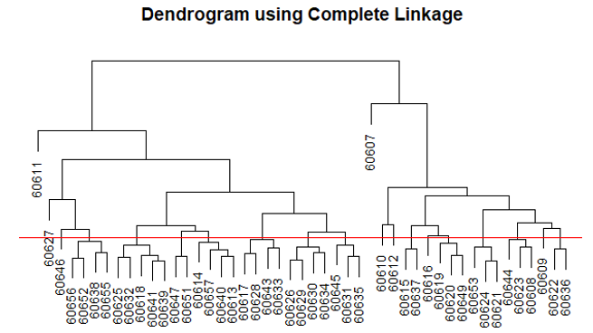
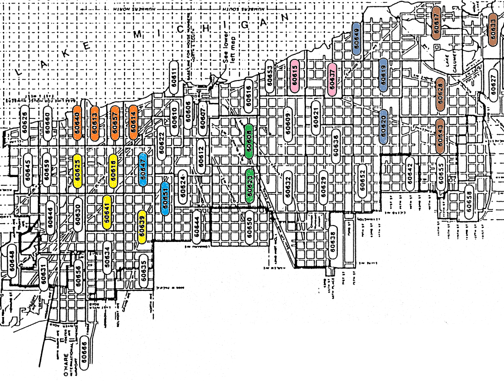

--- 
title: "Statistics"
author: ''
date: "`r Sys.Date()`"
site: bookdown::bookdown_site
---

# Overview

This website will feature some worked examples from different areas of statistics.

You can also check out my larger articles on [my website](https://zhigenlin.com).

```{r setup, include=FALSE}
knitr::opts_chunk$set(
  echo = FALSE,
  message = FALSE,
  warning = FALSE
)
```

<!--chapter:end:index.Rmd-->

# Petrol price

(Note: In the article, there is a known error where ARIMA(2,1,3) is chosen despite not having the lowest AIC. In addition, AICc may be more appropriate over AIC. Looking for outliers in the initial time series is also omitted.)

```{r}
knitr::opts_chunk$set(warning = FALSE)
 # Suppress warnings
```

This article uses an ARIMA time series model for weekly petrol price data over a period of about 13 years.

## Exploratory data analysis

```{r}
petrol.data <- read.csv("data/petrol.csv",stringsAsFactors=TRUE, header=F)

iterations.max = 300

library(fpp3)

n = length(petrol.data[,1])

petrolorig <- tsibble(
        Week = 1:n,
        Cost = ts(petrol.data[,1]),
        index = Week
)

petrol <- tsibble(
        Week = yearweek(1:n),
        Cost = ts(petrol.data[,1]),
        index = Week
)

petrolorig %>%
        autoplot() +
        labs(title = "Weekly Petrol Prices") +
        xlab("Week") + ylab("Petrol Price")

# zoom in
# petrolorig %>%
#         slice(1:32) %>% autoplot()

```

*Figure 1 – Plot of weekly petrol prices series*

In Figure 1, non-constant variance is present as the variance in the period between about week 450 to week 625 seems larger than the rest of the data, particularly the period shortly after week 600. There is an upwards linear trend in the data, which a slow exponentially-decaying sample ACF plot would easily confirm.

There are no obvious cycles or seasonality. Seasonality is not clearly present even if we zoom in on the plot for a small number of weeks. In any case, even if we wanted to model seasonality for weekly data, the fact that there is a (large) non-integer amount of weeks in a year (52.2) is problematic.

## Converting to a stationary series

We will apply a mathematical transformation and first differencing to adjust for heteroskedasticity and the linear trend respectively.

The *fable* package suggests that a Box-Cox transformation with $\lambda = -0.71$ is reasonable according to the *guerrero* feature. For simplicity, we will use $\lambda = -1$ instead.

Let $y_t$ be the original series, then the transformed series (after a mathematical transformation and first differencing), is given by

$$z_t = -(y_t^{-1} - y_{t-1}^{-1}).$$

```{r}
petrol %>% features(Cost, guerrero)
lambda <- petrol %>%
        features(Cost, guerrero) %>%
        pull(lambda_guerrero)
lvalue = round(lambda)

petrolchanged <- petrol %>%
        mutate(Cost = box_cox(Cost, lambda))

# second plot
petroldifftransf <- tsibble(
        #Week = yearweek(1:(n-1)),
        Week = (1:(n-1)),
        Cost = diff(ts(petrolchanged$Cost)),
        index = Week
)

petroldifftransf %>%
        autoplot() +
        labs(title = "Transformed Weekly Petrol Prices") +
        xlab("Week") + ylab("Transformed Petrol Price")
```

*Figure 2 – Plot of transformed weekly petrol prices series*

In Figure 2, we can see that the transformed series looks fairly stationary with little trend and the Box-Cox transformation has been helpful in adjusting for the non-constant variance.

## Selecting appropriate ARIMA model

```{r}
z = ts(petrolchanged$Cost)
tseries::adf.test(diff(z)[-1],k=0) # stationary

petrol %>% fabletools::model(mod = ARIMA(box_cox(Cost,lvalue))) %>% fabletools::report()

petrolchanged %>% 
        gg_tsdisplay(difference(Cost), plot_type='partial') +
        labs(y="Seasonally differenced")
```

*Figure 3 – Plots of sample autocorrelation and sample partial autocorrelation*

The sample ACF and PACF plots in Figure 3 exceed the confidence interval boundaries are multiple points and give no particular indication that a pure AR or MA model would fit our transformed series.

## Choose between models using AIC
```{r}
freq=52
petrol.ts = ts(petrolchanged$Cost,freq=freq)
diffpetrol.new = diff(petrol.ts)
p_max=3
q_max=3
aic = matrix(0,ncol=q_max+1,nrow=p_max+1)
for (i in 0:p_max) { #previously started at 1
        for (j in 0:q_max) {
                fitARMAmle=arima(diffpetrol.new,order=c(i,0,j),method='ML',optim.control = list(maxit=iterations.max))
                aic[i+1,j+1]=AIC(fitARMAmle)
        }
}
result = which(aic == min(aic), arr.ind=TRUE)
#result[1]-1
#result[2]-1
#min(aic)
rownames(aic) = 0:3
colnames(aic) = 0:3
aic
```

If we use a loop across different ARIMA models (varying degrees of AR and MA, keeping the differencing level fixed) we find that the best model according to AIC is ARIMA(2,1,3), which agrees with the model found by the order found by *fable*’s automatic ARIMA() function. Hence, we choose this model. (It may be useful to consider other types of models at this point too, but this article will focus on ARIMA.)

The final model after back-transforming is

$$
y_t = \left( \frac{1}{y_{t-1}} + \underset{(0.22)}{1.35} \left( \frac{1}{y_{t-1}} - \frac{1}{y_{t-2}} \right) - \underset{(0.14)}{0.57} \left( \frac{1}{y_{t-2}} - \frac{1}{y_{t-3}} \right) - e_t + \underset{(0.22)}{0.81} e_{t-1} - \underset{(0.06)}{0.23} e_{t-2} - \underset{(0.07)}{0.11} e_{t-3} \right)^{-1},
$$

where the numbers underneath are standard errors for the parameter estimates. Note that the estimate for $\sigma^2$ is $9.3 \times 10^{-5}$.

## Diagnostic tests and assessing model adequacy

An augmented Dickey-Fuller test on the transformed series gives a p-value of less than 0.01, indicating that the transformed series is probably stationary.

Let us now perform a Ljung-Box test for the null hypothesis that the residuals after fitting the ARIMA model are white noise.

```{r}
s = 4
# choose based on frequency of data
# e.g. monthly data s=12, quarterly s=4, weekly s=4 or 5

seasonality = TRUE # parameter
if (seasonality) {lag1 = 2*s} else {lag1 = 10}

T1 = length(petrolchanged$Cost); threshold = T1/5
if (lag1>threshold) {lag1 = round(threshold)}

arimafit = petrol %>% model(mod = ARIMA(box_cox(Cost,lvalue)))
dof1 = arimafit %>% coef() %>% dim() %>% first()

augment(arimafit) %>%
        features(.innov, ljung_box, lag=lag1, dof=dof1)
```

According to Hyndman and Athanasopoulos (2021), it is advisable to choose our lag to be $\min(10, n/5 \approx 140) = 10$ for this test, where $n$ is the number of observations in our time series. Hence, we choose our lag to be 10 and we have 5 degrees of freedom (for two AR parameters and 3 MA parameters). The resulting p-value is 0.542, well above any typical significance level such as 0.05. Therefore, we conclude that there is insufficient evidence to reject the null hypothesis that the residuals after fitting the ARIMA(2,1,3) model are white noise.

```{r}
qplot(sample = .innov, data = augment(arimafit)) + stat_qq_line() +
        labs(title = "Quantile-Quantile Plot") + xlab("Gaussian Quantiles") + ylab("Residuals") + theme(aspect.ratio=1)
```

*Figure 4 – Quantile-Quantile Plot*

The inverse transformation followed by differencing seemed to produce a stationary time series. The Ljung-Box p-value suggested that ARIMA(2,1,3) was a good fit, while the Q-Q plot casts doubt on whether prediction intervals based on the normal distribution can be trusted.

## References

Hyndman, R.J., & Athanasopoulos, G. (2021). Forecasting: Principles and Practice (3rd ed.). Melbourne, Australia: OTexts.

<!--chapter:end:02-Ch2.Rmd-->

# Insurance redlining

```{r}
knitr::opts_chunk$set(warning = FALSE)
 # Suppress warnings
```

```{r}
chicago.data = read.csv("data/chicago.csv")
group2 = c(60625,60641,60618,60639)
group3 = c(60651,60647)
group4 = c(60640,60613,60657,60614)
group5 = c(60623,60608)
group6 = c(60615,60637)
group7 = c(60620,60619,60649)
group8 = c(60643,60628,60617,60633)
g60618 = colMeans(chicago.data[chicago.data$Zip %in% group2,])
g60647 = colMeans(chicago.data[chicago.data$Zip %in% group3,])
g60613 = colMeans(chicago.data[chicago.data$Zip %in% group4,])
g60608 = colMeans(chicago.data[chicago.data$Zip %in% group5,])
g60615 = colMeans(chicago.data[chicago.data$Zip %in% group6,])
g60619 = colMeans(chicago.data[chicago.data$Zip %in% group7,])
g60617 = colMeans(chicago.data[chicago.data$Zip %in% group8,])
newgroups = c(group2,group3,group4,group5,group6,group7,group8)
newgps = t(data.frame(g60618,g60647,g60613,g60608,g60615,g60619,g60617))
names(newgps) = names(chicago.data)
chicago = chicago.data[!(chicago.data$Zip %in% newgroups),]
chicago = rbind(chicago,newgps)
rownames(chicago) = 1:length(chicago[,1])
chicago$Zip[27:33] = c(60618, 60647, 60613, 60608, 60615, 60619, 60617)

chicago2 = chicago[chicago$Invol!=0,]
chicago$Invol=chicago$Invol+0.01

AcceptRate = (chicago$Volun)/(chicago$Volun+chicago$Invol)
AcceptRate2 = (chicago2$Volun)/(chicago2$Volun+chicago2$Invol)

chicago=chicago[,-c(1)]
chicago2=chicago2[,-c(1)]
covar = chicago[c(3,4,8)]
covar2 = chicago2[c(3,4,8)]
covar3 = chicago[-c(1,6,7)]
covar4 = chicago2[-c(1,6,7)]

```

## 1.0 Introduction
In this report, we analyse Chicago insurance data collected between December 1977 and February 1978. Insurance companies are not allowed to discriminate based on race or age of housing, called ‘redlining’. Our primary interest is to study whether they did discriminate based on these factors in Chicago after taking other factors into account. If the extent of redlining is significant, the state could pursue a case to reprimand the behaviour of the Chicago insurance industry, or they could investigate particular insurance companies more deeply.

## 2.0 Setting up the data
Our data is identified according to zip codes and we have variables for race (in % minority), fire (per 1,000 housing units), theft (per 1,000 housing units), age (% of units built in or before 1939), income (median family income in 10,000 US dollars), voluntary market activity (per 100 housing units) and involuntary market activity (per 100 housing units). Note that income has been divided by 10,000 so that regression coefficients are easier to write down. There are 47 zip codes in the dataset.

### 2.1 The observations


*Figure 1 – Dendrogram created using hierarchical clustering of covariates between zip codes*

We compare the dendrogram to a map of Chicago and merge the adjacent zip codes as in Figure 2.


*Figure 2 – Map of Chicago in 1977/78 with ‘similar’ zip codes coloured*

The data we have is classified according to zip codes and we may have an issue regarding independence between observations (an assumption for standard linear models). Our proposed solution to this is to merge some of zip codes together.
We use hierarchical clustering to determine which zip codes exhibit the most similar characteristics with regards to the scaled covariates (race, fire, theft, age and income). We exclude the response from this process as we want to provide a possible legal case for redlining and do not want to fit a model that will be biased towards the result that we want.

Above a certain point in the Euclidean-distance dendrogram created by hierarchical clustering, as shown in Figure 1, we merge any zip codes that are adjacent to each other on a map of Chicago at the time. The choice of cut-off was motivated by comparing dendrograms created using ‘complete’ linkage versus ‘single’ linkage and seeing which of the same groups were formed. (Intuitively speaking, complete linkage looks at the farthest Euclidean distance between covariates in groups, while single linkage looks at the closest.) Another motivation for the cut-off is to retain a sufficient number of observations in our dataset.

There is a question on how exactly we should merge the data between the zip codes. We decide to simply take the mean of all variables data collected for the zip codes in the same group and regard it as a single zip code observation. This is arguably reasonable as the postcodes are supposed to have similar values for the covariates, and fire and theft are already standardised to every 1,000 housing units. The number of zip codes is reduced from 47 to 33.

### 2.2 The variables

The variables voluntary market activity and involuntary market activity are effectively the number of accepted insurance policies and rejected insurance policies respectively. Since we will use a standard linear model, we can only have one response variable, so we define a new variable,


$$
AcceptRate = \left(
\frac{\text{Voluntary market activity}}
{\text{Voluntary market activity} + (\text{Involuntary market activity} + 0.01)}
\right),
$$

and

$$
Accept = \Phi^{-1}(AcceptRate),
$$
where $\Phi^{-1}$ is the inverse of the cumulative distribution function of the standard normal distribution (i.e. the probit function). Our final response variable will be Accept, but AcceptRate is a useful intermediate result.

AcceptRate is a proportion variable between 0 and 1 non-inclusive. Applying the probit function allows us to match the range of the response with the range of linear predictor of the regression, while also making the response look more bell-shaped.

## 3.0 Standard Linear Model

We proceed to fit a linear model to the data using the standard lm function in R. Our strategy will be to fit the best possible model with Accept as the response and fire, theft and income as the covariates. Then, we will use added variable plots to check if race or age is relevant to the regression.

### 3.1 Exploratory Data Analysis

```{r pairs-plot-insurance}
pairs(cbind(AcceptRate,covar),main="Pairs Plot of Insurance Data",panel=function(x,y){points(x,y);lines(lowess(x,y))})
```
*Figure 3 - Pairs plot of insurance data*

Prior to fitting our model, we will make a few plots using our initial covariates. We will use AcceptRate rather than Accept in these plots as they are roughly distributed in the same way, but AcceptRate is always between 0 and 1, which will be more interpretable on the vertical axis.

The pairs plot of our initial covariates and AcceptRate is shown in Figure 3. As expected, we see some clear correlations between AcceptRate and Fire, and AcceptRate and Income, which are negative and positive respectively. Theft alone appears to be a poor determinant of AcceptRate. There also does not appear to be a multicollinearity problem between the covariates. Similarly, we can confirm that there are no multicollinearity issues between any of race, fire, theft, age and income in a larger pairs plot.

```{r}
covari = as.matrix(covar)
covarsc = covari %*% diag(1/sqrt(diag(crossprod(covari))))
covarsc = data.frame(covarsc)
names(covarsc)=names(covar)

condition = chicago$Race>50
black = chicago[condition,]
notblack = chicago[!condition,]

covar5 = black[c(3,4,8)]
covar6 = notblack[c(3,4,8)]

covar5sc = covarsc[condition,]
covar6sc = covarsc[!condition,]

AcceptRateBlack = AcceptRate[condition]
AcceptRateNotBlack = AcceptRate[!condition]

plot(covar5$Fire,AcceptRateBlack,type="n",
     xlab="Fire",
     ylab="AcceptRate",
     main="AcceptRate vs Fire",
     xlim=c(min(covar$Fire),max(covar$Fire)+0.5),
     ylim=c(0,max(AcceptRate)+0.1))
symbols(covar5$Fire,AcceptRateBlack,rectangles=cbind(covar5sc$Theft,covar5sc$Income), add=T, inches=1/2)
symbols(covar6$Fire,AcceptRateNotBlack,rectangles=cbind(covar6sc$Theft,covar6sc$Income), add=T, inches=1/2,fg='red')
legend("bottomleft",legend=c("Majority minority races","Majority Caucasian","Width=Theft","Height=Income"),pch=c(0,0,NA,NA),col=c("black","red"))
```
*Figure 4 – Symbol coplot of AcceptRate against Fire*

We can investigate the relationship between these variables more closely using a symbol co-plot as in Figure 4.

The plot has been colour-coded according to whether a zip code has minority races comprising over 50% of the zip code population. It should be noted that two-thirds of the zip codes had a majority Caucasian population.

We can see a clustering of points on the top left, with low fire risk, high AcceptRate, high income, relatively low theft and high proportion of Caucasians. Theft does not appear to play a major factor as we discussed earlier, although there is an observation with high theft and high AcceptRate on the far right. As before, we see a negative correlation between fire and AcceptRate and a positive correlation between income and AcceptRate. There is a thin observation in the middle with unusually low theft, but fire risk may be dragging its AcceptRate down. Overall, there is some evidence that race may be a factor in AcceptRate, but there may well be a confounding factor that explains what we are seeing. In fact, we achieve quite a similar plot if we colour-code for above or below the median percentage for age.

```{r}
x = as.matrix(covar[,c(1,2,3)])
maxiter = 100
library("MASS")
Accept = qnorm(AcceptRate)
x.value = rlm(x[,2]~x[,-2],maxit=maxiter)$resid
y.value = rlm(Accept~x[,-2],maxit=maxiter)$resid
plot(x.value, y.value,main="Added Variable Plot for Theft",
     xlab="Fitting Theft to other covariates (residuals)",
     ylab="Fitting Accept without Theft (residuals)")
```
*Figure 5 - Added variable plot for Theft in a regression to explain Accept*

One thing to investigate is whether theft is relevant in a model that includes fire and income since evidence of theft’s explanatory power was not convincing in Figures 3 and 4.

We create an added variable plot for theft in Figure 5. Note that we use Accept rather than AcceptRate now since we will be fitting using Accept. We will use Accept from now onwards.

There is no clear linear pattern in Figure 5, so we conclude that theft is probably not relevant for this model. We can also use principal components analysis on the covariates to determine that over 90% of the variation information in the covariates is contained within two variables, so it is likely that one of fire, theft or income is not necessary.

### 3.2 Variable Selection

```{r}

library("leaps")
Xtraining=x
Ytraining=Accept

Cpsel=leaps(Xtraining,Ytraining,method="Cp",nbest=2) 

plot((Cpsel$size-1),Cpsel$Cp,main="Exhaustive Variable Selection (Mallow's C_p)",xlab="Number of Covariates",ylab="Mallows's Cp")
```
```{r}
r2sel=leaps(Xtraining,Ytraining,method="adjr2",nbest=2)

plot((r2sel$size-1),r2sel$adjr2,main="Exhaustive Variable Selection (Adjusted R-Squared)",xlab="Number of Covariates",ylab="Adjusted R-Squared")
```

When designing a model for prediction, it is known that parsimonious models tend to perform the best. However, our purpose here is slightly different. We want to lean slightly more towards explaining Accept as much as possible using only fire, theft and income.

Then if we can show that race or age is still relevant, the argument that redlining is occurring may be more convincing to a legal authority.

We employ exhaustive variable selection including all squared and interaction terms. Some results are shown in Figure 6. We can see that the best model according to Mallow’s $C_p$ criterion should have three variables, while according to adjusted $R^{2}$, the best model should have five variables (leading to an adjusted $R^{2}$ of 92.8%).

The best model according to Mallow’s $C_p$ criterion should include fire, fire2 and the interaction term between fire and income. According to adjusted $R^{2}$, the best model includes all the ones from the Mallow’s $C_p$ model, as well as income and income2. As expected, theft does not feature in the preferred models as it showed no real pattern in its added variable plot (Figure 5).

Since it would make sense to include income if we are including an interaction term that involves income, we will choose to go halfway in between and include income but not income2, noting that the results for the $C_{p}$ criterion as well as adjusted $R^{2}$ are reasonable in this case too.
The interaction term between fire and income is difficult to comprehend, but one interpretation may be that residents those with lower incomes may not have as much time or motivation to maintain their residences in a fire-conscious way and more fires may occur in these residences as a result. In addition, it should be noted that the magnitude of the correlation between fire and income is higher than both the magnitude of correlation between theft and fire or theft and income.

### 3.3 Model Diagnostics

The model we fit in the previous section is


$$
\widehat{Accept} =
\underset{(0.909)}{3.061}
- \underset{(0.078)}{0.383}\,Fire
+ \underset{(0.688)}{0.557}\,Income
+ \underset{(0.001)}{0.006}\,Fire^2
+ \underset{(0.054)}{0.107}\,(Fire \times Income)
$$

where

$$
Accept = \Phi^{-1}\left(
\frac{\text{Voluntary market activity}}
{\text{Voluntary market activity} + (\text{Involuntary market activity} + 0.01)}
\right).
$$
*Equation 1 – Model with fire, income, fire2 and the interaction between fire and income fit using the ‘lm’ function in R*

Notably, the adjusted $R^{2}$ of this regression is quite good (0.9263) and the p-values for the coefficients are all significant at the 5% level except income and the interaction between fire and income at 0.42 and 0.06 respectively. The coefficient for fire2 is quite small, but we gave our reasoning in the previous section as to why we may want to keep slightly more covariates in the model rather than seeking the most parsimonious model.

```{r}
sqcovar = (covar)^2
TheftIncome = covar$Theft*covar$Income
FireTheft = covar$Fire*covar$Theft
FireIncome = covar$Fire*covar$Income
names(sqcovar) = c("Fire2","Theft2","Income2")

supervar = data.frame(covar,sqcovar,TheftIncome,FireTheft,FireIncome)
model = lm(Accept~Fire+Income+Fire2+FireIncome,data=supervar)
plot(fitted(model),residuals(model),
     main="Residual Plot",
     xlab="Fitted Values",
     ylab="Residuals")
abline(h=0,col="grey")
```
*Figure 7 - Residual plot*

In Figure 7, we find that the mean of residuals is approximately zero in the residuals plot, so the linearity assumption is fine. The independence of errors assumption is satisfied, as there is also no distinguishable pattern, although there is a clump of points to the right, which correspond to the zip codes with zero involuntary market activity. Although omitted, in the absolute residual plot, we see a very desirable flat LOWESS fit.

```{r}
par(mfcol=c(2,2))
par(pty="s")
qqnorm(residuals(model),
       main="Quantile-Quantile Plot",
       xlab="Gaussian Quantiles",
       ylab="Residuals")
qqline(residuals(model))
abline(v=0,col='grey'); abline(h=0,col='grey')
par(pty="m")

cd = cooks.distance(model)
side = length(cd)
plot(cd, main="Cook's Distance",
     xlab="Case Number",
     ylab="Cook's Distance",ylim=c(0,max(1,cd)))
segments(c(1:side),0,c(1:side),cd)
abline(h=1, col='red')

absstandard = abs(rstudent(model))
side = length(absstandard)
plot(absstandard, main="Absolute Standardised Residuals",
     xlab="Case Number",
     ylab="Abs Standardised Residuals",ylim=c(0,max(3,absstandard)))
segments(c(1:side),0,c(1:side),absstandard)
abline(h=qnorm(0.975), col='red')

explanatory_variables = length(coef(model))-1
number_of_observations = length(covar[,1])

side = length(hatvalues(model))
plot(1:side,hatvalues(model),ylim=c(0,max(hatvalues(model))),
     main="Leverage Points",
     xlab="Case Number",
     ylab="Leverage")
segments(c(1:side),0,c(1:side),hatvalues(model))
abline(h=2*(explanatory_variables+1)/number_of_observations, col='red')
par(mfcol=c(1,1))
```
*Figure 8 – Q-Q, standardised residuals, Cook’s distance and leverage points*

In Figure 8, from the Q-Q plot, we find that the data has possible extremely slight positive skew, but the normality assumption is essentially satisfied. There looks to be one observation that falls dramatically off the Q-Q line, which is observation 2.

From the Cook’s distance plot, we can see that the largest Cook’s distances correspond to observations 2, 3 and 13 and 18, though none of them exceed 1 (which is often taken as a heuristic cut-off). We will investigate these four observations further in the two plots on the right side.

In the absolute standardised residuals plot, a conservative cut-off is approximately at 2, so observations 2 and 13 may be a concern. In the leverage plot, observations 3 and 13 have high leverage. Hence, we may consider removing some or all observations 2, 3 and 13 and 18.

If we refit the model with any of observations 3, 13, 2 or 18 removed (in a sequential sense), we find some small differences in coefficients, but no drastic changes. The adjusted $R^{2}$ stays virtually the same and replotting the Cook’s Distance plot after removing observations does not show anything special. Hence, we decide not to remove any observations for now.

## 4.0 Added Variable Plots for Race and Age

```{r}
tryRace = data.frame(supervar$Fire,supervar$Income,supervar$Fire2,supervar$FireIncome,covar3$Race)
x = as.matrix(tryRace)
maxiter = 100
x.value = rlm(x[,5]~x[,-5],maxit=maxiter)$resid
y.value = rlm(Accept~x[,-5],maxit=maxiter)$resid
plot(x.value, y.value,main="Added Variable Plot for Race",
     xlab="Fitting Race to other covariates (residuals)",
     ylab="Fitting Accept without Race (residuals)")
model5 = rlm(y.value~x.value); abline(model5,col='red')

```
```{r}
tryAge = data.frame(supervar$Fire,supervar$Income,supervar$Fire2,supervar$FireIncome,covar3$Age)
x = as.matrix(tryAge)
x.value = lm(x[,5]~x[,-5])$resid
y.value = lm(Accept~x[,-5])$resid
plot(x.value, y.value,main="Added Variable Plot for Age",
     xlab="Fitting Age to other covariates (residuals)",
     ylab="Fitting Accept without Age (residuals)")
model6 = lm(y.value~x.value); abline(model5,col='red')
```
*Figure 9 – Added variable plots for race and age*

We can finally set out to study whether race or age is relevant given the model we have previously fitted. The plots in Figure 9 show that both race or age are not relevant in a model that accounts for fire, fire2, income and the interaction term between fire and income. There is no strong apparent pattern in either plot. The plot for race might a slight linear relationship, but the correlation is low (about 30% in magnitude). Additionally, a straight-line fit either directly in the plot or in a regression with the four chosen variables plus race does not output a significant p-value at the 5% significance level (the p-values are 0.084 and 0.107 respectively).

It should be noted that these plots were created using the lm function in R. If, however, we fit the added variable plot for race using robust linear regression (rlm), the straight-line fit actually does become significant at the 5% level.

However, it quickly returns to being insignificant once we remove the high-leverage observation 3 from our dataset, implying that the relationship is not important.

## 5.0 Conclusion

The final model we have chosen is Equation 1 in section 3.3.

Our purpose in this report was to study whether race or age were relevant in accepted or rejected insurance policies in order to determine whether redlining was occurring in Chicago between December 1977 and February 1978.

Initial symbol co-plots indicated that race or age may be relevant. Once we fit the best model we could using fire, theft and income, we investigated whether race or age was still relevant. The added variable plots showed that they were not and there is no substantive evidence of redlining.

<!--chapter:end:03-Ch3.Rmd-->

# Chickenpox Time Series

```{r}
knitr::opts_chunk$set(warning = FALSE)
 # Suppress warnings
```

## Introduction

Treatment of chickenpox (varicella) cases uses up significant economic resources in Hungary. The Hungarian authorities were interested in the past in determining whether widespread distribution of a chickenpox vaccine would be appropriate (Meszner, Molnar, Rampakakis, Yang, Kuter, & Lara, 2017). The data used for this project are 521 weekly Hungarian chickenpox case counts by county from 2005 to 2014 inclusive, with Budapest regarded as its own administrative region. This data were provided publicly by Rozemberczki, Scherer, Kiss, Sarkar, and Ferenci (2021) and downloaded from the UCI Machine Learning Repository (University of California, 2021).

The decision to make vaccines publicly available was already approved in 2018 (“Hungary to provide chickenpox vaccine”, 2018). Nevertheless, the data set may still be able to provide additional insights.

My research question is to study whether population density plays a role in the behaviour of the time series. I am interested in whether higher population density may result in a greater number of “super-spreader” events. One key factor will be seasonality in the data set, as it is thought that that colder seasons and the timing of the school year have a significant effect on chickenpox cases (Rozemberczki et al., 2021). This may have different effects in the regions of differing population density.

A natural choice in answering this research question is to fit multiplicative seasonal ARIMA models to the chickenpox case numbers, as we can study both seasonality and the case-number dependence on previous values and forecast errors. We will do so for four chosen Hungarian regions.

## Exploratory data analysis

Administratively, Hungary is split up into its counties, while the capital city, Budapest, is given a separate designation. Budapest which has, by far, the highest population density in the data set, was an obvious choice to include in my study. Of the remaining data sets, I have chosen the counties with the highest, median and lowest population densities, which are Pest, Heves and Somogy respectively (Hungarian Central Statistical Office, 2019).

On a technical note, I chose to aggregate the weekly data into monthly data. Weekly data is difficult to handle for many reasons, particularly since the seasonal period is not exactly 52 (Hyndman & Athanasopoulos, 2021).

```{r}
plot1 <- function() {par(mfrow=c(1,1),mar=c(5.1,4.1,4.1,2.1),mgp=c(3,1,0),oma=c(0,0,0,0))}

chickenpox = read.csv("data/hungary_chickenpox.csv",header=T,stringsAsFactors = F)

library(fpp3)
library(writexl)
library(bayesforecast)
library(forecast)

chickenpox$Date = as.Date(chickenpox$Date, "%d/%m/%Y")
pox = chickenpox %>% as_tsibble(index = Date)
season = 12; test = 12; itns = 2000

# convert to monthly data
buda1 = pox %>% select(BUDAPEST) %>% index_by(Month = yearmonth(Date)) %>% summarise(Cases=sum(BUDAPEST))
# check for outliers
buda1_decomp <- buda1 %>% fabletools::model(STL(Cases)) %>% components()
buda1_decomp %>% filter(remainder < quantile(remainder, 0.25) - 4*IQR(remainder) | remainder > quantile(remainder, 0.75) + 4*IQR(remainder))
# adjust for heteroskedasticity
bc.lambda.buda <- buda1 %>% features(Cases, guerrero) %>% pull(lambda_guerrero)

par(mfcol=c(4,1),mar=c(1,2.75,1,1),mgp=c(1.75,.75,0),oma=c(1.5,0,0,0))
plot.buda = ts(as.numeric(buda1$Cases),freq=season,start=2005)
plot(plot.buda,xaxt = "n",type='o',ylab="Budapest")

pest1 = pox %>% select(PEST) %>% index_by(Month = yearmonth(Date)) %>% summarise(Cases=sum(PEST))
pest1_decomp <- pest1 %>% fabletools::model(STL(Cases)) %>% components()
pest1_decomp %>% filter(remainder < quantile(remainder, 0.25) - 4*IQR(remainder) | remainder > quantile(remainder, 0.75) + 4*IQR(remainder))
bc.lambda.pest <- pest1 %>% features(Cases, guerrero) %>% pull(lambda_guerrero)
plot.pest = ts(as.numeric(pest1$Cases),freq=season,start=2005)
plot(plot.pest,xaxt = "n",type='o',ylab="Pest")

heves1 = pox %>% select(HEVES) %>% index_by(Month = yearmonth(Date)) %>% summarise(Cases=sum(HEVES))
heves1_decomp <- heves1 %>% fabletools::model(STL(Cases)) %>% components()
heves1_decomp %>% filter(remainder < quantile(remainder, 0.25) - 4*IQR(remainder) | remainder > quantile(remainder, 0.75) + 4*IQR(remainder))
bc.lambda.heves <- heves1 %>% features(Cases, guerrero) %>% pull(lambda_guerrero)
plot.heves = ts(as.numeric(heves1$Cases),freq=season,start=2005)
plot(plot.heves,xaxt = "n",type='o',ylab="Heves")

somogy1 = pox %>% select(SOMOGY) %>% index_by(Month = yearmonth(Date)) %>% summarise(Cases=sum(SOMOGY))
somogy1_decomp <- somogy1 %>% fabletools::model(STL(Cases)) %>% components()
somogy1_decomp %>% filter(remainder < quantile(remainder, 0.25) - 4*IQR(remainder) | remainder > quantile(remainder, 0.75) + 4*IQR(remainder))
bc.lambda.somogy <- somogy1 %>% features(Cases, guerrero) %>% pull(lambda_guerrero)
plot.somogy = ts(as.numeric(somogy1$Cases),freq=season,start=2005)
plot(plot.somogy,xaxt = "n",type='o',ylab="Somogy")
dates = as.Date(somogy1$Month); sequence = attributes(plot.somogy)$tsp
axis(1, at = seq(sequence[1], sequence[2], along = plot.somogy), labels = format(dates, "%Y-%m"))
```
*Figure 1 – Monthly chickenpox cases in Budapest, Pest, Heves, and Somogy from 2005 to 2014*

Let us define an outlier as an observation that is either greater than 3 interquartile ranges above the 0.75 quantile, or 3 interquartile ranges below the 0.25 quantile, a fairly strict criteria detailed by Hyndman and Athanasopoulos (2021).

The only observation that qualifies as an outlier under this criteria is the case number for January 2007 in the Heves series, which has a very clear peak in Figure 1. However, if we replace this observation with the average of the cases in January of the preceding and subsequent year, this outlier case disappears, but the very next month, February 2007 exceeds the outlier threshold value. Likewise, this behaviour repeats if we adjust the February 2007 observation. This process repeats itself until we replace the April 2007 observation, but then other observations at different times are flagged. Hence, it can be regarded that these values may not be true outliers, such as a once-off super-spreader event. Therefore, no change is made to the Heves series.

## Methodology

### Initial setup

This project will use R to fit Bayesian models (R Core Team, 2021). The interface used to write in R is RStudio (RStudio Team, 2021). The Stan programming language is indirectly used (Carpenter et al., 2017). Please see Appendices 1 and 2 for R packages used and R code respectively.
The aggregation into monthly data was done computationally using the fpp3 package in R, which automatically loads some packages in the tidyverse collection of packages (Hyndman, 2021). This reduces the number of observations to 120 months’ worth of case counts, of which we will take 108 as training data and 12 as test data.
Finally, as discussed in Hyndman and Athanasopoulos (2021), fpp3 is used to determine the value for $\lambda$ in a Box-Cox transformation, in order to adjust for heteroskedasticity in the time series. Assuming the untransformed monthly series is $(x_t)$, this transformation is achieved for non-zero $\lambda$ via the formula $y_t = (x_t^\lambda - 1)/\lambda$.

Central to our methodology is the R package bayesforecast, which interfaces with the programming language Stan, to fit Bayesian time series models (Alonzo & Cruz, 2020).

### Order selection

bayesforecast used for ARIMA order selection, the algorithm for which is described below. Note that the process compares the BIC of frequentist fittings to find the preferred order.

Firstly, the following constraints are made for a multiplicative seasonal ARIMA model

$$
y_t \sim SARIMA(p,d,q)(P,D,Q)_{12}
$$

- $p + q + P + Q \leq 6$
- $d + D \leq 2$
- $0 \leq p \leq 5, 0 \leq d \leq 2, 0 \leq q \leq 5$
- $0 \leq P \leq 2, 0 \leq D \leq 2, 0 \leq Q \leq 2$

Steps for model selection, with exhaustive search and approximations off (stepwise=FALSE,approximation=FALSE), are based on the algorithm by Hyndman and Khandakar (2008). The first two steps are used to ensure stationarity.

1. Use Kwiatkowski–Phillips–Schmidt–Shin test(s) to determine $d$.
2. Use the period of an STL decomposition to determine $D$.
3. Exhaustively check the BIC of all possible models within the constraints to determine the preferred ${p,d,q,P,D,Q}$.

### Prior and posterior distributions

#### Sampling model
As previously, take $(x_t)$ as the untransformed monthly series. After the Box-Cox transformation, we have
$y_t = (x_t^\lambda - 1)/\lambda$.

We can determine from our fittings in Section 2.2 that the maximum order of coefficients for the models we need to fit for our sampling model is

$$y_t | \boldsymbol{\gamma} \sim \text{SARIMA}(1,0,2)(2,1,2)_{12}$$
where $\boldsymbol{\gamma}$ represents the parameters of the model.

Hence, we can simply determine the posterior distribution assuming this model, but all of the fitted models will have lower order coefficients than this one.

Our sampling model is equivalently expressed as described below.
$$
(1-\phi B)(1-\Phi_1 B^{12}-\Phi_2 B^{24})(1-B^{12})(y_t-\mu)
=
(1+\theta_1 B+\theta_2 B^2)(1+\Theta_1 B^{12}+\Theta_2 B^{24})\epsilon_t
$$

Therefore,

$$
\begin{aligned}
y_t ={}& \mu + \epsilon_t + \theta_1\epsilon_{t-1}
+ \theta_2\epsilon_{t-2} + \Theta_1\epsilon_{t-12}
+ \theta_1\Theta_1\epsilon_{t-13}
+ \theta_2\Theta_1\epsilon_{t-14}
+ \Theta_2\epsilon_{t-24}
+ \theta_1\Theta_2\epsilon_{t-25} \\
&+ \theta_2\Theta_2\epsilon_{t-26}
+ \phi(y_{t-1}-\mu)
+ (1+\Phi_1)(y_{t-12}-\mu)
- (\phi+\phi\Phi_1)(y_{t-13}-\mu) \\
&+ (\Phi_2-\Phi_1)(y_{t-24}-\mu)
+ (\phi\Phi_1-\phi\Phi_2)(y_{t-25}-\mu)
- \Phi_2(y_{t-36}-\mu) \\
&+ \phi\Phi_2(y_{t-37}-\mu),
\quad \epsilon_t \mid \sigma \sim N(0, sd=\sigma).
\end{aligned}
$$
(Equation 1)

Take $\epsilon_{11} = \cdots = \epsilon_{36} = 0$.

Hence, the likelihood for our sampling model is given by

$$
\begin{aligned}
y_t \mid \{&\mu, \sigma, \phi, \Phi_1, \Phi_2, \theta_1, \theta_2,
\Theta_1, \Theta_2, \epsilon_t, \epsilon_{t-1}, \epsilon_{t-2},
\epsilon_{t-13}, \epsilon_{t-14}, \epsilon_{t-24},
\epsilon_{t-25}, \epsilon_{t-26}, \\
&y_{t-1}, y_{t-12}, y_{t-13}, y_{t-24}, y_{t-25},
y_{t-36}, y_{t-37}, y_1, \ldots, y_{36}\}
\sim N(*, sd=\sigma)
\end{aligned}
$$

where * is the expression on the right-hand side of Equation 1 and $t = 37, \cdots, 108. (In ARIMA models, the sampling model is assumed to be normal.)

Define 

$$
\begin{aligned}
\widehat{y}_t ={}& \mu + E[\epsilon_t]
+ \theta_1\epsilon_{t-1} + \theta_2\epsilon_{t-2}
+ \Theta_1\epsilon_{t-12}
+ \theta_1\Theta_1\epsilon_{t-13}
+ \theta_2\Theta_1\epsilon_{t-14}
+ \Theta_2\epsilon_{t-24}
+ \theta_1\Theta_2\epsilon_{t-25} \\
&+ \theta_2\Theta_2\epsilon_{t-26}
+ \phi(y_{t-1}-\mu)
+ (1+\Phi_1)(y_{t-12}-\mu)
- (\phi+\phi\Phi_1)(y_{t-13}-\mu) \\
&+ (\Phi_2-\Phi_1)(y_{t-24}-\mu)
+ (\phi\Phi_1-\phi\Phi_2)(y_{t-25}-\mu)
- \Phi_2(y_{t-36}-\mu) \\
&+ \phi\Phi_2(y_{t-37}-\mu) \\[1em]
={}& \mu + \theta_1\epsilon_{t-1} + \theta_2\epsilon_{t-2}
+ \Theta_1\epsilon_{t-12}
+ \theta_1\Theta_1\epsilon_{t-13}
+ \theta_2\Theta_1\epsilon_{t-14}
+ \Theta_2\epsilon_{t-24}
+ \theta_1\Theta_2\epsilon_{t-25}
+ \theta_2\Theta_2\epsilon_{t-26} \\
&+ \phi(y_{t-1}-\mu)
+ (1+\Phi_1)(y_{t-12}-\mu)
- (\phi+\phi\Phi_1)(y_{t-13}-\mu) \\
&+ (\Phi_2-\Phi_1)(y_{t-24}-\mu)
+ (\phi\Phi_1-\phi\Phi_2)(y_{t-25}-\mu)
- \Phi_2(y_{t-36}-\mu) \\
&+ \phi\Phi_2(y_{t-37}-\mu).
\end{aligned}
$$
(Equation 2)

At iteration $t$ of our algorithm, we will generate $\epsilon_t$ from
$\epsilon_t \mid \sigma \sim N(0, sd = \sigma)$ iid for $t = 37, \ldots, 108$.
However, for any iteration prior iteration $n = 1, \ldots, t$ set
$\epsilon_n = y_n - \widehat{y}_n$, as defined in Equation 2.

<!--chapter:end:04-Ch4.Rmd-->

