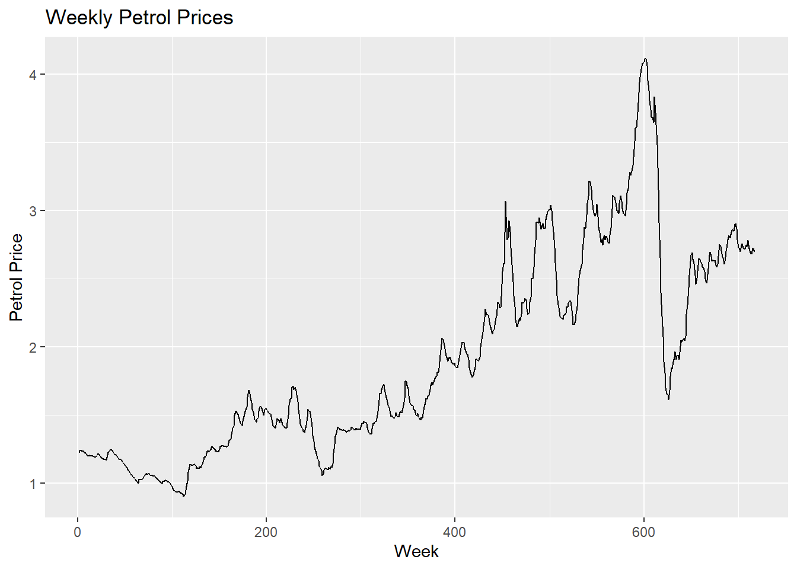
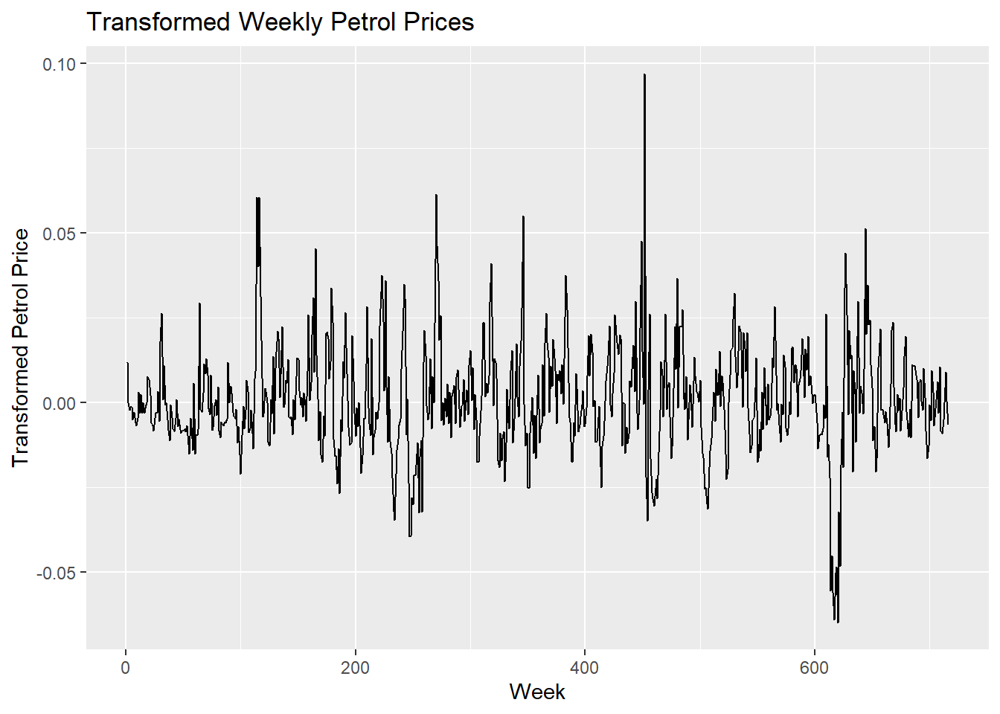
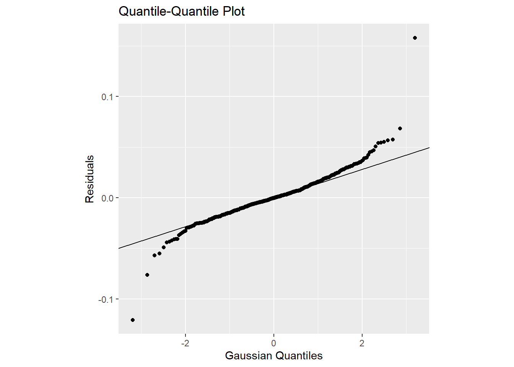

# Petrol price

(Note: In the article, there is a known error where ARIMA(2,1,3) is chosen despite not having the lowest AIC. In addition, AICc may be more appropriate over AIC. Looking for outliers in the initial time series is also omitted.)

This article uses an ARIMA time series model for weekly petrol price data over a period of about 13 years.

## Exploratory data analysis


``` r
petrol.data <- read.csv("data/petrol.csv",stringsAsFactors=TRUE, header=F)

iterations.max = 300

library(fpp3)
```

```
## ── Attaching packages ──────────────────────────────────────────── fpp3 1.0.3 ──
```

```
## ✔ tibble      3.3.1     ✔ tsibble     1.2.0
## ✔ dplyr       1.2.0     ✔ tsibbledata 0.4.1
## ✔ tidyr       1.3.2     ✔ ggtime      0.2.0
## ✔ lubridate   1.9.5     ✔ feasts      0.5.0
## ✔ ggplot2     4.0.2     ✔ fable       0.5.0
```

```
## ── Conflicts ───────────────────────────────────────────────── fpp3_conflicts ──
## ✖ lubridate::date()    masks base::date()
## ✖ dplyr::filter()      masks stats::filter()
## ✖ tsibble::intersect() masks base::intersect()
## ✖ tsibble::interval()  masks lubridate::interval()
## ✖ dplyr::lag()         masks stats::lag()
## ✖ tsibble::setdiff()   masks base::setdiff()
## ✖ tsibble::union()     masks base::union()
```

``` r
n = length(petrol.data[,1])

petrolorig <- tsibble(
        Week = 1:n,
        Cost = ts(petrol.data[,1]),
        index = Week
)

petrol <- tsibble(
        Week = yearweek(1:n),
        Cost = ts(petrol.data[,1]),
        index = Week
)

petrolorig %>%
        autoplot() +
        labs(title = "Weekly Petrol Prices") +
        xlab("Week") + ylab("Petrol Price")
```

```
## Plot variable not specified, automatically selected `.vars = Cost`
```



``` r
# zoom in
# petrolorig %>%
#         slice(1:32) %>% autoplot()
```

*Figure 1 – Plot of weekly petrol prices series*

In Figure 1, non-constant variance is present as the variance in the period between about week 450 to week 625 seems larger than the rest of the data, particularly the period shortly after week 600. There is an upwards linear trend in the data, which a slow exponentially-decaying sample ACF plot would easily confirm.

There are no obvious cycles or seasonality. Seasonality is not clearly present even if we zoom in on the plot for a small number of weeks. In any case, even if we wanted to model seasonality for weekly data, the fact that there is a (large) non-integer amount of weeks in a year (52.2) is problematic.

## Converting to a stationary series

We will apply a mathematical transformation and first differencing to adjust for heteroskedasticity and the linear trend respectively.

The *fable* package suggests that a Box-Cox transformation with $\lambda = -0.71$ is reasonable according to the *guerrero* feature. For simplicity, we will use $\lambda = -1$ instead.

Let $y_t$ be the original series, then the transformed series (after a mathematical transformation and first differencing), is given by

$$z_t = -(y_t^{-1} - y_{t-1}^{-1}).$$


``` r
petrol %>% features(Cost, guerrero)
```

```
## # A tibble: 1 × 1
##   lambda_guerrero
##             <dbl>
## 1          -0.493
```

``` r
lambda <- petrol %>%
        features(Cost, guerrero) %>%
        pull(lambda_guerrero)
lvalue = round(lambda)

petrolchanged <- petrol %>%
        mutate(Cost = box_cox(Cost, lambda))

# second plot
petroldifftransf <- tsibble(
        #Week = yearweek(1:(n-1)),
        Week = (1:(n-1)),
        Cost = diff(ts(petrolchanged$Cost)),
        index = Week
)

petroldifftransf %>%
        autoplot() +
        labs(title = "Transformed Weekly Petrol Prices") +
        xlab("Week") + ylab("Transformed Petrol Price")
```

```
## Plot variable not specified, automatically selected `.vars = Cost`
```



*Figure 2 – Plot of transformed weekly petrol prices series*

In Figure 2, we can see that the transformed series looks fairly stationary with little trend and the Box-Cox transformation has been helpful in adjusting for the non-constant variance.

## Selecting appropriate ARIMA model


``` r
z = ts(petrolchanged$Cost)
tseries::adf.test(diff(z)[-1],k=0) # stationary
```

```
## Registered S3 method overwritten by 'quantmod':
##   method            from
##   as.zoo.data.frame zoo
```

```
## Warning in tseries::adf.test(diff(z)[-1], k = 0): p-value smaller than printed
## p-value
```

```
## 
## 	Augmented Dickey-Fuller Test
## 
## data:  diff(z)[-1]
## Dickey-Fuller = -13.445, Lag order = 0, p-value = 0.01
## alternative hypothesis: stationary
```

``` r
petrol %>% fabletools::model(mod = ARIMA(box_cox(Cost,lvalue))) %>% fabletools::report()
```

```
## Series: Cost 
## Model: ARIMA(1,1,1) 
## Transformation: box_cox(Cost, lvalue) 
## 
## Coefficients:
##          ar1      ma1
##       0.7168  -0.2103
## s.e.  0.0428   0.0597
## 
## sigma^2 estimated as 0.0003335:  log likelihood=1850.96
## AIC=-3695.91   AICc=-3695.88   BIC=-3682.19
```

``` r
petrolchanged %>% 
        gg_tsdisplay(difference(Cost), plot_type='partial') +
        labs(y="Seasonally differenced")
```

```
## Warning: Removed 1 row containing missing values or values outside the scale range
## (`geom_line()`).
```

```
## Warning: Removed 1 row containing missing values or values outside the scale range
## (`geom_point()`).
```


*Figure 3 – Plots of sample autocorrelation and sample partial autocorrelation*

The sample ACF and PACF plots in Figure 3 exceed the confidence interval boundaries are multiple points and give no particular indication that a pure AR or MA model would fit our transformed series.

## Choose between models using AIC

``` r
freq=52
petrol.ts = ts(petrolchanged$Cost,freq=freq)
diffpetrol.new = diff(petrol.ts)
p_max=3
q_max=3
aic = matrix(0,ncol=q_max+1,nrow=p_max+1)
for (i in 0:p_max) { #previously started at 1
        for (j in 0:q_max) {
                fitARMAmle=arima(diffpetrol.new,order=c(i,0,j),method='ML',optim.control = list(maxit=iterations.max))
                aic[i+1,j+1]=AIC(fitARMAmle)
        }
}
result = which(aic == min(aic), arr.ind=TRUE)
#result[1]-1
#result[2]-1
#min(aic)
rownames(aic) = 0:3
colnames(aic) = 0:3
aic
```

```
##           0         1         2         3
## 0 -3872.747 -4087.614 -4134.328 -4167.551
## 1 -4182.046 -4187.773 -4185.781 -4192.133
## 2 -4187.124 -4185.776 -4184.407 -4193.625
## 3 -4187.073 -4186.247 -4193.785 -4191.757
```

If we use a loop across different ARIMA models (varying degrees of AR and MA, keeping the differencing level fixed) we find that the best model according to AIC is ARIMA(2,1,3), which agrees with the model found by the order found by *fable*’s automatic ARIMA() function. Hence, we choose this model. (It may be useful to consider other types of models at this point too, but this article will focus on ARIMA.)

The final model after back-transforming is

$$
y_t = \left( \frac{1}{y_{t-1}} + \underset{(0.22)}{1.35} \left( \frac{1}{y_{t-1}} - \frac{1}{y_{t-2}} \right) - \underset{(0.14)}{0.57} \left( \frac{1}{y_{t-2}} - \frac{1}{y_{t-3}} \right) - e_t + \underset{(0.22)}{0.81} e_{t-1} - \underset{(0.06)}{0.23} e_{t-2} - \underset{(0.07)}{0.11} e_{t-3} \right)^{-1},
$$

where the numbers underneath are standard errors for the parameter estimates. Note that the estimate for $\sigma^2$ is $9.3 \times 10^{-5}$.

## Diagnostic tests and assessing model adequacy

An augmented Dickey-Fuller test on the transformed series gives a p-value of less than 0.01, indicating that the transformed series is probably stationary.

Let us now perform a Ljung-Box test for the null hypothesis that the residuals after fitting the ARIMA model are white noise.


``` r
s = 4
# choose based on frequency of data
# e.g. monthly data s=12, quarterly s=4, weekly s=4 or 5

seasonality = TRUE # parameter
if (seasonality) {lag1 = 2*s} else {lag1 = 10}

T1 = length(petrolchanged$Cost); threshold = T1/5
if (lag1>threshold) {lag1 = round(threshold)}

arimafit = petrol %>% model(mod = ARIMA(box_cox(Cost,lvalue)))
dof1 = arimafit %>% coef() %>% dim() %>% first()

augment(arimafit) %>%
        features(.innov, ljung_box, lag=lag1, dof=dof1)
```

```
## # A tibble: 1 × 3
##   .model lb_stat lb_pvalue
##   <chr>    <dbl>     <dbl>
## 1 mod       14.6    0.0240
```

According to Hyndman and Athanasopoulos (2021), it is advisable to choose our lag to be $\min(10, n/5 \approx 140) = 10$ for this test, where $n$ is the number of observations in our time series. Hence, we choose our lag to be 10 and we have 5 degrees of freedom (for two AR parameters and 3 MA parameters). The resulting p-value is 0.542, well above any typical significance level such as 0.05. Therefore, we conclude that there is insufficient evidence to reject the null hypothesis that the residuals after fitting the ARIMA(2,1,3) model are white noise.


``` r
qplot(sample = .innov, data = augment(arimafit)) + stat_qq_line() +
        labs(title = "Quantile-Quantile Plot") + xlab("Gaussian Quantiles") + ylab("Residuals") + theme(aspect.ratio=1)
```

```
## Warning: `qplot()` was deprecated in ggplot2 3.4.0.
## This warning is displayed once per session.
## Call `lifecycle::last_lifecycle_warnings()` to see where this warning was
## generated.
```



*Figure 4 – Quantile-Quantile Plot*

The inverse transformation followed by differencing seemed to produce a stationary time series. The Ljung-Box p-value suggested that ARIMA(2,1,3) was a good fit, while the Q-Q plot casts doubt on whether prediction intervals based on the normal distribution can be trusted.

## References

Hyndman, R.J., & Athanasopoulos, G. (2021). Forecasting: Principles and Practice (3rd ed.). Melbourne, Australia: OTexts.
