# Introduction {#intro}

Treatment of chickenpox (varicella) cases uses up significant economic resources in Hungary. The Hungarian authorities were interested in the past in determining whether widespread distribution of a chickenpox vaccine would be appropriate (Meszner, Molnar, Rampakakis, Yang, Kuter, & Lara, 2017). The data used for this project are 521 weekly Hungarian chickenpox case counts by county from 2005 to 2014 inclusive, with Budapest regarded as its own administrative region. This data were provided publicly by Rozemberczki, Scherer, Kiss, Sarkar, and Ferenci (2021) and downloaded from the UCI Machine Learning Repository (University of California, 2021).

The decision to make vaccines publicly available was already approved in 2018 ("Hungary to provide chickenpox vaccine", 2018). Nevertheless, the data set may still be able to provide additional insights.

My research question is to study whether population density plays a role in the behaviour of the time series. I am interested in whether higher population density may result in a greater number of "super-spreader" events. One key factor will be seasonality in the data set, as it is thought that that colder seasons and the timing of the school year have a significant effect on chickenpox cases (Rozemberczki et al., 2021). This may have different effects in the regions of differing population density.

A natural choice in answering this research question is to fit multiplicative seasonal ARIMA models to the chickenpox case numbers, as we can study both seasonality and the case-number dependence on previous values and forecast errors. We will do so for four chosen Hungarian regions.

# Exploratory data analysis {#eda}

Administratively, Hungary is split up into its counties, while the capital city, Budapest, is given a separate designation. Budapest which has, by far, the highest population density in the data set, was an obvious choice to include in my study. Of the remaining data sets, I have chosen the counties with the highest, median and lowest population densities, which are Pest, Heves and Somogy respectively (Hungarian Central Statistical Office, 2019).

On a technical note, I chose to aggregate the weekly data into monthly data. Weekly data is difficult to handle for many reasons, particularly since the seasonal period is not exactly 52 (Hyndman & Athanasopoulos, 2021).


``` r
plot1 <- function() {par(mfrow=c(1,1),mar=c(5.1,4.1,4.1,2.1),mgp=c(3,1,0),oma=c(0,0,0,0))}

chickenpox = read.csv("data/hungary_chickenpox.csv",header=T,stringsAsFactors = F)

library(fpp3)
```

```
## ── Attaching packages ──────────────────────────────────────────── fpp3 1.0.3 ──
```

```
## ✔ tibble      3.3.1     ✔ tsibble     1.2.0
## ✔ dplyr       1.2.0     ✔ tsibbledata 0.4.1
## ✔ tidyr       1.3.2     ✔ ggtime      0.2.0
## ✔ lubridate   1.9.5     ✔ feasts      0.5.0
## ✔ ggplot2     4.0.2     ✔ fable       0.5.0
```

```
## ── Conflicts ───────────────────────────────────────────────── fpp3_conflicts ──
## ✖ lubridate::date()    masks base::date()
## ✖ dplyr::filter()      masks stats::filter()
## ✖ tsibble::intersect() masks base::intersect()
## ✖ tsibble::interval()  masks lubridate::interval()
## ✖ dplyr::lag()         masks stats::lag()
## ✖ tsibble::setdiff()   masks base::setdiff()
## ✖ tsibble::union()     masks base::union()
```

``` r
library(writexl)
library(bayesforecast)
```

```
## Registered S3 methods overwritten by 'bayesforecast':
##   method      from    
##   autoplot.ts forecast
##   forecast.ts forecast
##   fortify.ts  forecast
```

```
## 
## Attaching package: 'bayesforecast'
```

```
## The following objects are masked from 'package:fabletools':
## 
##     model, report
```

```
## The following objects are masked from 'package:base':
## 
##     beta, gamma
```

``` r
library(forecast)
```

```
## 
## Attaching package: 'forecast'
```

```
## The following objects are masked from 'package:bayesforecast':
## 
##     fourier, naive
```

``` r
chickenpox$Date = as.Date(chickenpox$Date, "%d/%m/%Y")
pox = chickenpox %>% as_tsibble(index = Date)
season = 12; test = 12; itns = 2000

# convert to monthly data, decompose (for outlier checks) and
# find the Box-Cox lambda (to adjust for heteroskedasticity)
buda1 = pox %>% select(BUDAPEST) %>% index_by(Month = yearmonth(Date)) %>% summarise(Cases=sum(BUDAPEST))
buda1_decomp <- buda1 %>% fabletools::model(STL(Cases)) %>% components()
bc.lambda.buda <- buda1 %>% features(Cases, guerrero) %>% pull(lambda_guerrero)
plot.buda = ts(as.numeric(buda1$Cases),freq=season,start=2005)

pest1 = pox %>% select(PEST) %>% index_by(Month = yearmonth(Date)) %>% summarise(Cases=sum(PEST))
pest1_decomp <- pest1 %>% fabletools::model(STL(Cases)) %>% components()
bc.lambda.pest <- pest1 %>% features(Cases, guerrero) %>% pull(lambda_guerrero)
plot.pest = ts(as.numeric(pest1$Cases),freq=season,start=2005)

heves1 = pox %>% select(HEVES) %>% index_by(Month = yearmonth(Date)) %>% summarise(Cases=sum(HEVES))
heves1_decomp <- heves1 %>% fabletools::model(STL(Cases)) %>% components()
bc.lambda.heves <- heves1 %>% features(Cases, guerrero) %>% pull(lambda_guerrero)
plot.heves = ts(as.numeric(heves1$Cases),freq=season,start=2005)

somogy1 = pox %>% select(SOMOGY) %>% index_by(Month = yearmonth(Date)) %>% summarise(Cases=sum(SOMOGY))
somogy1_decomp <- somogy1 %>% fabletools::model(STL(Cases)) %>% components()
bc.lambda.somogy <- somogy1 %>% features(Cases, guerrero) %>% pull(lambda_guerrero)
plot.somogy = ts(as.numeric(somogy1$Cases),freq=season,start=2005)
```


``` r
par(mfcol=c(4,1),mar=c(1,2.75,1,1),mgp=c(1.75,.75,0),oma=c(1.5,0,0,0))
plot(plot.buda,xaxt = "n",type='o',ylab="Budapest")
plot(plot.pest,xaxt = "n",type='o',ylab="Pest")
plot(plot.heves,xaxt = "n",type='o',ylab="Heves")
plot(plot.somogy,xaxt = "n",type='o',ylab="Somogy")
dates = as.Date(somogy1$Month); sequence = attributes(plot.somogy)$tsp
axis(1, at = seq(sequence[1], sequence[2], along = plot.somogy), labels = format(dates, "%Y-%m"))
```

<div class="figure">
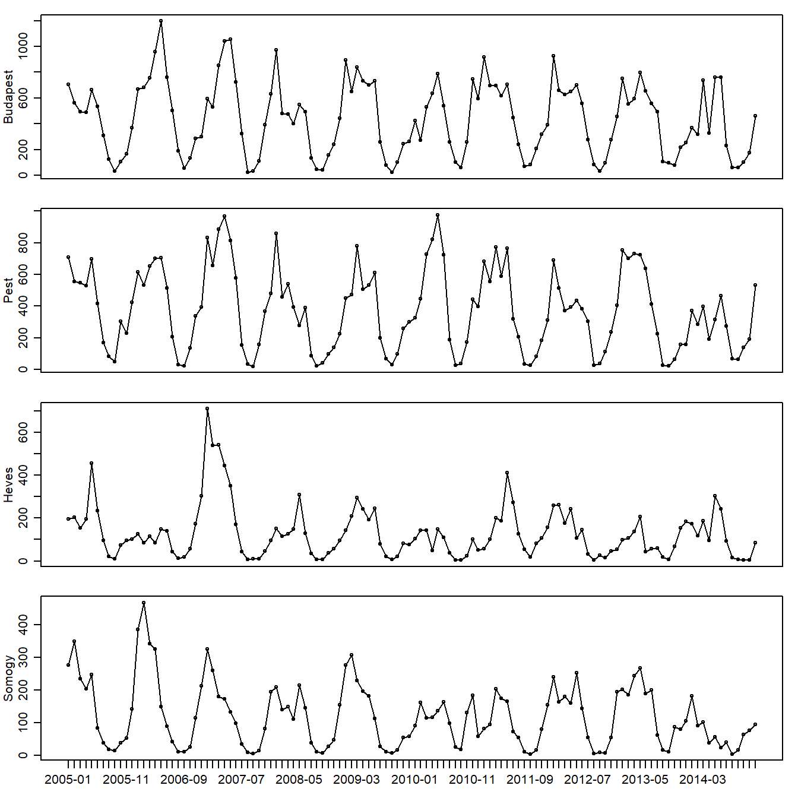
<p class="caption">(\#fig:eda-plot)Monthly chickenpox cases in Budapest, Pest, Heves, and Somogy from 2005 to 2014</p>
</div>

Let us define an outlier as an observation that is either greater than 3 interquartile ranges above the 0.75 quantile, or 3 interquartile ranges below the 0.25 quantile, a fairly strict criteria detailed by Hyndman and Athanasopoulos (2021).


``` r
# check for outliers in the STL remainder
flag_outliers <- function(decomp, region) {
  decomp %>%
    filter(remainder < quantile(remainder, 0.25) - 4*IQR(remainder) |
           remainder > quantile(remainder, 0.75) + 4*IQR(remainder)) %>%
    as_tibble() %>%
    transmute(Region = region, Month = format(Month), Cases, Remainder = round(remainder, 1))
}
outliers <- bind_rows(
  flag_outliers(buda1_decomp, "Budapest"),
  flag_outliers(pest1_decomp, "Pest"),
  flag_outliers(heves1_decomp, "Heves"),
  flag_outliers(somogy1_decomp, "Somogy")
)
knitr::kable(outliers, caption = "Observations flagged by the outlier rule applied to the STL remainder")
```


Table: (\#tab:outliers)Observations flagged by the outlier rule applied to the STL remainder

|Region |Month    | Cases| Remainder|
|:------|:--------|-----:|---------:|
|Heves  |2007 Jan |   712|     345.6|

The only observation that qualifies as an outlier under this criteria (Table \@ref(tab:outliers)) is the case number for January 2007 in the Heves series, which has a very clear peak in Figure \@ref(fig:eda-plot). However, if we replace this observation with the average of the cases in January of the preceding and subsequent year, this outlier case disappears, but the very next month, February 2007 exceeds the outlier threshold value. Likewise, this behaviour repeats if we adjust the February 2007 observation. This process repeats itself until we replace the April 2007 observation, but then other observations at different times are flagged. Hence, it can be regarded that these values may not be true outliers, such as a once-off super-spreader event. Therefore, no change is made to the Heves series.

# Methodology {#methodology}

## Initial setup {#initial-setup}

This project will use R to fit Bayesian models (R Core Team, 2021). The interface used to write in R is RStudio (RStudio Team, 2021). The Stan programming language is indirectly used (Carpenter et al., 2017). Please see Appendices \@ref(appendix-packages) and \@ref(appendix-code) for R packages used and R code respectively.

The aggregation into monthly data was done computationally using the fpp3 package in R, which automatically loads some packages in the tidyverse collection of packages (Hyndman, 2021). This reduces the number of observations to 120 months' worth of case counts, of which we will take 108 as training data and 12 as test data.

Finally, as discussed in Hyndman and Athanasopoulos (2021), fpp3 is used to determine the value for $\lambda$ in a Box-Cox transformation, in order to adjust for heteroskedasticity in the time series. Assuming the untransformed monthly series is $(x_t)$, this transformation is achieved for non-zero $\lambda$ via the formula $y_t = (x_t^\lambda - 1)/\lambda$.

Central to our methodology is the R package bayesforecast, which interfaces with the programming language Stan, to fit Bayesian time series models (Alonzo & Cruz, 2020).

## Order selection {#order-selection}

bayesforecast used for ARIMA order selection, the algorithm for which is described below. Note that the process compares the BIC of frequentist fittings to find the preferred order.

Firstly, the following constraints are made for a multiplicative seasonal ARIMA model

$$
y_t \sim SARIMA(p,d,q)(P,D,Q)_{12}
$$

- $p + q + P + Q \leq 6$
- $d + D \leq 2$
- $0 \leq p \leq 5, 0 \leq d \leq 2, 0 \leq q \leq 5$
- $0 \leq P \leq 2, 0 \leq D \leq 2, 0 \leq Q \leq 2$

Steps for model selection, with exhaustive search and approximations off (`stepwise=FALSE`, `approximation=FALSE`), are based on the algorithm by Hyndman and Khandakar (2008). The first two steps are used to ensure stationarity.

1. Use Kwiatkowski–Phillips–Schmidt–Shin test(s) to determine $d$.
2. Use the period of an STL decomposition to determine $D$.
3. Exhaustively check the BIC of all possible models within the constraints to determine the preferred $\{p,d,q,P,D,Q\}$.

## Prior and posterior distributions {#prior-posterior}

### Sampling model {#sampling-model}

As previously, take $(x_t)$ as the untransformed monthly series. After the Box-Cox transformation, we have
$y_t = (x_t^\lambda - 1)/\lambda$.

We can determine from our fittings in Section \@ref(order-selection) that the maximum order of coefficients for the models we need to fit for our sampling model is

$$y_t | \boldsymbol{\gamma} \sim \text{SARIMA}(1,0,2)(2,1,2)_{12}$$

where $\boldsymbol{\gamma}$ represents the parameters of the model.

Hence, we can simply determine the posterior distribution assuming this model, but all of the fitted models will have lower order coefficients than this one.

Our sampling model is equivalently expressed as described below.

$$
(1-\phi B)(1-\Phi_1 B^{12}-\Phi_2 B^{24})(1-B^{12})(y_t-\mu)
=
(1+\theta_1 B+\theta_2 B^2)(1+\Theta_1 B^{12}+\Theta_2 B^{24})\epsilon_t
$$

Therefore,

\begin{equation}
\begin{aligned}
y_t ={}& \mu + \epsilon_t + \theta_1\epsilon_{t-1} + \theta_2\epsilon_{t-2}
+ \Theta_1\epsilon_{t-12} + \theta_1\Theta_1\epsilon_{t-13} \\
&+ \theta_2\Theta_1\epsilon_{t-14} + \Theta_2\epsilon_{t-24}
+ \theta_1\Theta_2\epsilon_{t-25} + \theta_2\Theta_2\epsilon_{t-26} \\
&+ \phi(y_{t-1}-\mu) + (1+\Phi_1)(y_{t-12}-\mu)
- (\phi+\phi\Phi_1)(y_{t-13}-\mu) \\
&+ (\Phi_2-\Phi_1)(y_{t-24}-\mu)
+ (\phi\Phi_1-\phi\Phi_2)(y_{t-25}-\mu)
- \Phi_2(y_{t-36}-\mu) \\
&+ \phi\Phi_2(y_{t-37}-\mu),
\qquad \epsilon_t \mid \sigma \sim N(0, sd=\sigma).
\end{aligned}
(\#eq:sarima)
\end{equation}

Take $\epsilon_{11} = \cdots = \epsilon_{36} = 0$.

Hence, the likelihood for our sampling model is given by

$$
\begin{aligned}
y_t \mid \{&\mu, \sigma, \phi, \Phi_1, \Phi_2, \theta_1, \theta_2,
\Theta_1, \Theta_2, \\
&\epsilon_t, \epsilon_{t-1}, \epsilon_{t-2},
\epsilon_{t-13}, \epsilon_{t-14}, \epsilon_{t-24},
\epsilon_{t-25}, \epsilon_{t-26}, \\
&y_{t-1}, y_{t-12}, y_{t-13}, y_{t-24}, y_{t-25},
y_{t-36}, y_{t-37}, y_1, \ldots, y_{36}\}
\sim N(*, sd=\sigma)
\end{aligned}
$$

where $*$ is the expression on the right-hand side of Equation \@ref(eq:sarima) and $t = 37, \ldots, 108$. (In ARIMA models, the sampling model is assumed to be normal.)

Define

\begin{equation}
\begin{aligned}
\widehat{y}_t ={}& \mu + E[\epsilon_t] + \theta_1\epsilon_{t-1} + \theta_2\epsilon_{t-2}
+ \Theta_1\epsilon_{t-12} + \theta_1\Theta_1\epsilon_{t-13} \\
&+ \theta_2\Theta_1\epsilon_{t-14} + \Theta_2\epsilon_{t-24}
+ \theta_1\Theta_2\epsilon_{t-25} + \theta_2\Theta_2\epsilon_{t-26} \\
&+ \phi(y_{t-1}-\mu) + (1+\Phi_1)(y_{t-12}-\mu)
- (\phi+\phi\Phi_1)(y_{t-13}-\mu) \\
&+ (\Phi_2-\Phi_1)(y_{t-24}-\mu)
+ (\phi\Phi_1-\phi\Phi_2)(y_{t-25}-\mu)
- \Phi_2(y_{t-36}-\mu) \\
&+ \phi\Phi_2(y_{t-37}-\mu) \\[1em]
={}& \mu + \theta_1\epsilon_{t-1} + \theta_2\epsilon_{t-2}
+ \Theta_1\epsilon_{t-12} + \theta_1\Theta_1\epsilon_{t-13} \\
&+ \theta_2\Theta_1\epsilon_{t-14} + \Theta_2\epsilon_{t-24}
+ \theta_1\Theta_2\epsilon_{t-25} + \theta_2\Theta_2\epsilon_{t-26} \\
&+ \phi(y_{t-1}-\mu) + (1+\Phi_1)(y_{t-12}-\mu)
- (\phi+\phi\Phi_1)(y_{t-13}-\mu) \\
&+ (\Phi_2-\Phi_1)(y_{t-24}-\mu)
+ (\phi\Phi_1-\phi\Phi_2)(y_{t-25}-\mu)
- \Phi_2(y_{t-36}-\mu) \\
&+ \phi\Phi_2(y_{t-37}-\mu).
\end{aligned}
(\#eq:yhat)
\end{equation}

At iteration $t$ of our algorithm, we will generate $\epsilon_t$ from
$\epsilon_t \mid \sigma \sim N(0, sd = \sigma)$ iid for $t = 37, \ldots, 108$.
However, for any iteration prior iteration $n = 1, \ldots, t$ set
$\epsilon_n = y_n - \widehat{y}_n$, as defined in Equation \@ref(eq:yhat).

### Priors {#priors}

We do not have any strong information or intuition on the priors, so we set priors that are considered weakly informative for the scale of typical ARIMA coefficients (Stan Development Team, 2021).

-   $\mu\ \sim\ N(mu = 0,\ sd = 10)$

-   $\sigma\ \sim\ Half\ Cauchy(mu = 0,\ sd = 5),\ \ \ \ \ \ \sigma > 0$

-   $\phi\ \sim\ N(0,\ 2)$

-   $\Phi_{j}\ \sim\ N(0,\ 2)\ iid,\ \ \ \ \ j = 1,2$

-   $\theta_{k}\ \sim\ N(0,\ 2)\ iid,\ \ \ \ \ k = 1,2$

-   $\Theta_{l}\ \sim\ N(0,\ 2)\ iid,\ \ \ \ \ \ l = 1,2$

Note that we treat all the priors as independent and while 10 parameters are listed here, all models fitted will be a subset of this model (and the true largest number of parameters fitted for any one model is 6).

### Conditional posterior distributions {#conditional-posteriors}

Let

-   $\mathbf{y} = \left( y_{37},\ldots,y_{108} \right),$

-   $\mathbf{\epsilon} = \left( \epsilon_{37},\ldots,\epsilon_{108} \right),$

-   $\mathbf{\gamma} = \left( \mu,\sigma,\phi,\Phi_{1},\Phi_{2},\theta_{1},\theta_{2},\Theta_{1},\Theta_{2} \right),$ and

-   $\lambda$ be the right-hand side of Equation \@ref(eq:sarima), that is,

$$
\begin{aligned}
\lambda ={}& \mu + \epsilon_{t} + \theta_{1}\epsilon_{t - 1} + \theta_{2}\epsilon_{t - 2}
+ \Theta_{1}\epsilon_{t - 12} + \theta_{1}\Theta_{1}\epsilon_{t - 13} \\
&+ \theta_{2}\Theta_{1}\epsilon_{t - 14} + \Theta_{2}\epsilon_{t - 24}
+ \theta_{1}\Theta_{2}\epsilon_{t - 25} + \theta_{2}\Theta_{2}\epsilon_{t - 26} \\
&+ \phi\left( y_{t - 1} - \mu \right) + \left( 1 + \Phi_{1} \right)\left( y_{t - 12} - \mu \right)
- \left( \phi + \phi\Phi_{1} \right)\left( y_{t - 13} - \mu \right) \\
&+ \left( \Phi_{2} - \Phi_{1} \right)\left( y_{t - 24} - \mu \right)
+ \left( \phi\Phi_{1} - \phi\Phi_{2} \right)\left( y_{t - 25} - \mu \right)
- \Phi_{2}\left( y_{t - 36} - \mu \right) \\
&+ \phi\Phi_{2}\left( y_{t - 37} - \mu \right).
\end{aligned}
$$

Since, we treat our parameters are independent, our conditional posterior distributions can be derived in the manner below, where all parameters can take any real value, except that $\sigma > 0$. Note that a minus in the subscript removes an element from a vector.

All parameters have been left in even if they are not directly relevant to the conditional distribution since we need to multiply all these distributions in our Markov chain Monte Carlo algorithm.

$$
\begin{aligned}
p\left( \mu \middle| \mathbf{y},\mathbf{\epsilon},\mathbf{\gamma}_{- \mu} \right)
&\propto \left\{ \prod_{t = 37}^{108}{p\left( y_{t} \middle| \mathbf{\gamma},\mathbf{\epsilon},\mathbf{y}_{- t} \right)} \right\}\ p(\mu) \\
&\propto \left\{ \prod_{t = 37}^{108}{\exp\left\lbrack - \frac{1}{2}\left( \frac{y_{t} - \lambda}{\sigma} \right)^{2} \right\rbrack} \right\}\ \exp\left\lbrack - \frac{1}{2}\left( \frac{\mu}{10} \right)^{2} \right\rbrack
\end{aligned}
$$

$$
\begin{aligned}
p\left( \sigma \middle| \mathbf{y},\mathbf{\epsilon},\mathbf{\gamma}_{- \sigma} \right)
&\propto \left\{ \prod_{t = 37}^{108}{p\left( y_{t} \middle| \mathbf{\gamma},\mathbf{\epsilon},\mathbf{y}_{- t} \right)} \right\}\ \left\{ \prod_{t = 37}^{108}{p\left( \epsilon_{t} \middle| \mathbf{\gamma},\mathbf{\epsilon}_{- t},\mathbf{y} \right)} \right\}\ p(\sigma) \\
&\propto \left\{ \prod_{t = 37}^{108}{\frac{1}{\sigma}\exp\left\lbrack - \frac{1}{2}\left( \frac{y_{t} - \lambda}{\sigma} \right)^{2} \right\rbrack} \right\}\ \left\{ \prod_{t = 37}^{108}{\frac{1}{\sigma}\exp\left\lbrack - \frac{1}{2}\left( \frac{\epsilon_{t}}{\sigma} \right)^{2} \right\rbrack} \right\} \\
&\qquad \times {\frac{1}{\sigma}\left( 1 + \left( \frac{\sigma}{5} \right)^{2} \right)}^{- 1} \\
&= \frac{1}{\sigma^{145}}\ \left\{ \prod_{t = 37}^{108}{\exp\left\lbrack - \frac{1}{2}\left( \left( \frac{y_{t} - \lambda}{\sigma} \right)^{2} + \left( \frac{\epsilon_{t}}{\sigma} \right)^{2} \right) \right\rbrack} \right\}\ \left( 1 + \left( \frac{\sigma}{5} \right)^{2} \right)^{- 1}
\end{aligned}
$$

$$p\left( \phi \middle| \mathbf{y},\mathbf{\epsilon},\mathbf{\gamma}_{- \phi} \right) \propto \left\{ \prod_{t = 37}^{108}{{\frac{1}{\sigma}\exp}\left\lbrack - \frac{1}{2}\left( \frac{y_{t} - \lambda}{\sigma} \right)^{2} \right\rbrack} \right\}\ \exp\left\lbrack - \frac{1}{2}\left( \frac{\phi}{2} \right)^{2} \right\rbrack$$

$$p\left( \Phi_{j} \middle| \mathbf{y},\mathbf{\epsilon},\mathbf{\gamma}_{- \Phi_{j}} \right) \propto \left\{ \prod_{t = 37}^{108}{{\frac{1}{\sigma}\exp}\left\lbrack - \frac{1}{2}\left( \frac{y_{t} - \lambda}{\sigma} \right)^{2} \right\rbrack} \right\}\ \exp\left\lbrack - \frac{1}{2}\left( \frac{\Phi_{j}}{2} \right)^{2} \right\rbrack$$

$$p\left( \theta_{k} \middle| \mathbf{y},\mathbf{\epsilon},\mathbf{\gamma}_{- \theta_{k}} \right) \propto \left\{ \prod_{t = 37}^{108}{{\frac{1}{\sigma}\exp}\left\lbrack - \frac{1}{2}\left( \frac{y_{t} - \lambda}{\sigma} \right)^{2} \right\rbrack} \right\}\ \exp\left\lbrack - \frac{1}{2}\left( \frac{\theta_{k}}{2} \right)^{2} \right\rbrack$$

$$p\left( \Theta_{l} \middle| \mathbf{y},\mathbf{\epsilon},\mathbf{\gamma}_{- \Theta_{l}} \right) \propto \left\{ \prod_{t = 37}^{108}{{\frac{1}{\sigma}\exp}\left\lbrack - \frac{1}{2}\left( \frac{y_{t} - \lambda}{\sigma} \right)^{2} \right\rbrack} \right\}\ \exp\left\lbrack - \frac{1}{2}\left( \frac{\Theta_{l}}{2} \right)^{2} \right\rbrack$$

$$
\begin{aligned}
p\left( \epsilon_{t} \middle| \mathbf{y},\mathbf{\epsilon}_{- \left\{ \geq t \right\}},\mathbf{\gamma} \right)
&\propto \left\{ \prod_{i = 37}^{t}{{\frac{1}{\sigma}\exp}\left\lbrack - \frac{1}{2}\left( \frac{y_{i} - \lambda}{\sigma} \right)^{2} \right\rbrack} \right\}\ \frac{1}{\sigma}\exp\left\lbrack - \frac{1}{2}\left( \frac{\epsilon_{t}}{\sigma} \right)^{2} \right\rbrack \\
&= \frac{1}{\sigma^{t - 37 + 2}}\ \left\{ \prod_{i = 37}^{t}{\exp\left\lbrack - \frac{1}{2}\left( \frac{y_{i} - \lambda}{\sigma} \right)^{2} \right\rbrack} \right\}\ \exp\left\lbrack - \frac{1}{2}\left( \frac{\epsilon_{t}}{\sigma} \right)^{2} \right\rbrack
\end{aligned}
$$

Note that the density function for the Half Cauchy distribution on $\sigma$ is proportional to (double) the density of the Cauchy distribution, except that the support is now $\sigma > 0$.

## Markov chain Monte Carlo algorithm {#mcmc}

The algorithm used to sample the conditional distributions of the variables is the one used in the Stan programming language, which is called the no-U-Turn sampler (Stan Development Team, 2021).

Note that the numbers of parameters $p$ varies depending on our four time series, but the maximum number of parameters fitted in one model is 6 and the minimum is 5. The initial parameter values are randomly generated (Stan Development Team, 2021).

The following algorithm is repeated 4 times, so that we have 4 chains.

**Algorithm steps**

Repeat the following steps for each iteration from $i = 1,\ldots,2000$. The burn-in period will be half of the iterations. Thinning is not required.

Recall that, at its maximum number of parameters, $\mathbf{\gamma} = \left( \mu,\sigma,\phi,\Phi_{1},\Phi_{2},\theta_{1},\theta_{2},\Theta_{1},\Theta_{2} \right)$.

Let the superscript in brackets correspond to the iteration number.

Hence define the joint distribution of all parameters

$$
\begin{aligned}
p\left( \mathbf{\gamma}|\mathbf{\gamma}^{(i - 1)} \right)
={}& p\left( \mu \middle| \mathbf{y},\mathbf{\epsilon},\mathbf{\gamma}_{- \mu}^{(i - 1)} \right)\ p\left( \sigma \middle| \mathbf{y},\mathbf{\epsilon},\mathbf{\gamma}_{- \sigma}^{(i - 1)} \right)\ p\left( \phi \middle| \mathbf{y},\mathbf{\epsilon},\mathbf{\gamma}_{- \phi}^{(i - 1)} \right) \\
&\times p\left( \Phi_{1} \middle| \mathbf{y},\mathbf{\epsilon},\mathbf{\gamma}_{- \Phi_{j}}^{(i - 1)} \right)\ p\left( \Phi_{2} \middle| \mathbf{y},\mathbf{\epsilon},\mathbf{\gamma}_{- \Phi_{j}}^{(i - 1)} \right)\ p\left( \theta_{1} \middle| \mathbf{y},\mathbf{\epsilon},\mathbf{\gamma}_{- \theta_{k}}^{(i - 1)} \right) \\
&\times p\left( \theta_{2} \middle| \mathbf{y},\mathbf{\epsilon},\mathbf{\gamma}_{- \theta_{k}}^{(i - 1)} \right)\ p\left( \Theta_{1} \middle| \mathbf{y},\mathbf{\epsilon},\mathbf{\gamma}_{- \Theta_{l}}^{(i - 1)} \right)\ p\left( \Theta_{2} \middle| \mathbf{y},\mathbf{\epsilon},\mathbf{\gamma}_{- \Theta_{l}}^{(i - 1)} \right) \\
&\times \left\{ \prod_{i = 37}^{108}{p\left( \epsilon_{t} \middle| \mathbf{y},\mathbf{\epsilon}_{- \left\{ \geq t \right\}},\mathbf{\gamma}^{(i - 1)} \right)} \right\}
\end{aligned}
$$

At iteration $i$ of the sampling algorithm:

**Step 1**

If $i \leq 1000$, set $M = I_{p}$. Otherwise, set $M$ as the reciprocal of the diagonal values from the covariance matrix of $\mathbf{\gamma}^{(i = 1000)}$.

**Step 2**

Draw $\rho\ \sim\ N_{p}(0,M)$ and $\epsilon_{t}\ \sim\ N(0,sd = \sigma)$.

**Step 3: Generate proposal values**

Let $\mathbf{\gamma}^{\mathbf{*}} = \mathbf{\gamma}^{(i - 1)}$.

Solve the differential equations

$$\frac{d\mathbf{\gamma}^{\mathbf{*}}}{dt} = - \frac{d\log\left( p(\rho) \right)}{d\rho},\ \ \frac{d\rho}{dt} = \frac{d\log{p\left( \mathbf{\gamma}^{\mathbf{*}}|\mathbf{\gamma}^{(i - 1)} \right)}}{d\mathbf{\gamma}^{\mathbf{*}}},$$

to obtain $\mathbf{\gamma}^{\mathbf{*}}$.

The way to solve these differential equations is complex and beyond the scope of this project. The no-U-Turn sampler uses a unique 'leapfrog' algorithm that involves binary trees (Stan Development Team, 2021).

**Step 4: Metropolis-like step**

Let $H\left( \rho,\mathbf{\gamma} \right) = - \log{p(\rho) - \log{p\left( \mathbf{\gamma} \right)}}$

Step 4a: Compute acceptance ratio

$$r = \exp\left\{ H\left( \rho,\mathbf{\gamma}^{(i - 1)} \right) - H\left( \rho,\mathbf{\gamma}^{*} \right) \right\}$$

Step 4b: Set $\mathbf{\gamma}^{(i)} = \mathbf{\gamma}^{*}$ if $r > 1$ and to $\mathbf{\gamma}^{(i - 1)}$ otherwise.

**Step 5:** Predict the value of $y_{t}$, called $\widehat{y_{t}}$ (see Equation \@ref(eq:yhat)), using the parameter values in $\mathbf{\gamma}^{(i)}$,

**Step 6:** Set $\epsilon_{t}^{(i)} = y_{t} - \widehat{y_{t}}$.

## Posterior predictive checks {#ppc}

After the algorithm is complete, extract all the columns of $\mathbf{\gamma} = \left( \mu,\sigma,\phi,\Phi_{1},\Phi_{2},\theta_{1},\theta_{2},\Theta_{1},\Theta_{2} \right)$ as MCMC chains.

For our posterior predictive checks, we will use the *Arima* function from the *forecast* package to simulate seasonal ARIMA models with fixed coefficient values. Our main test statistic will be to compare the model, which used 108 observations, to compare to the full set of 120 observations by simulating 120 observations. Two other test statistics will be used -- the ACF and PACF of the 120 observations, as these describe the dependence structure of the time series.

These posterior checks will be conducted against the original data set, aggregated to monthly data, i.e. prior to the Box-Cox transformation, and with the estimated mean parameter subtracted. The algorithm for posterior predictive draws will work as follows.

For 1,000 loops:

1.  From the post burn-in set of $\mathbf{\gamma}$ values, draw a particular row from the coefficient matrix (i.e. parameters from the same iteration).

2.  Use the *Arima* function to simulate the appropriate ARIMA model with coefficients fixed to those that were drawn in step 1.

3.  Calculate the test statistics for these simulations.

4.  Calculate the proportion of times whether the test statistics exceed the statistics from the real data set.

Note that the Heves and Somogy series, exhibit some instabilities when trying to simulate observations, possibly due to the MA or seasonal MA coefficients being close to non-invertible. This is easily fixed by settings a 'while' loop to keep simulating until there are no *NA* values. It should be noted that the Pest series had one seasonal MA coefficient, but did not require this adjustment.

# Results {#results}

## Convergence and posterior predictive checks {#convergence}

Note that even though $\epsilon$ is part of our sampling model, it is not a parameter of interest since its expected value is fixed at 0, so we ignore it for our convergence checks. Let ESS be effective sample size. Note that ESS can be larger than the number of MCMC iterations due to negative autocorrelations (Stan Development Team, 2021). Here, we are comparing to 4,000 iterations since we ran 1,000 post burn-in iterations for 4 chains.

### Budapest series {#budapest}

The order fitted is $y_{t}|\mathbf{\gamma}\ \sim\ SARIMA(1,0,0)(2,1,0)_{12}$.

The results for the MCMC algorithm are displayed in Table \@ref(tab:buda-mcmc). The effective sample sizes are far greater than 1,000 and the $\widehat{R}$ values do not exceed 1 by any significant amount. Note that we are not worried about the large value for $\sigma$ for the same reason as we are not interested in the convergence of $\epsilon$. The width of the 90% credible interval for $\mu$ appears potentially sizeable, but it is not too problematic on the overall scale of cases in Budapest, which are in the hundreds. The intervals of the other ARIMA coefficients seem reasonable and do not include 0.

The Box-Cox transformation parameter was determined to be $\lambda \approx 0.08$, so to convert back in terms of the original series $\left( x_{t} \right)$, we use $x_{t} = \left( \lambda y_{t} + 1 \right)^{1/\lambda}$.

| Parameter    | Mean  | Standard error | 0.05 quantile | 0.95 quantile | ESS  | $\widehat{R}$ |
|:-------------|------:|---------------:|--------------:|--------------:|-----:|--------------:|
| $\mu$        | 1.7   | 0.1            | -11.1         | 14.7          | 4091 | 1             |
| $\sigma$     | 149.1 | 0.2            | 133.5         | 167           | 3926 | 1             |
| $\phi$       | 0.5   | 0              | 0.4           | 0.6           | 3970 | 1             |
| $\Phi_{1}$   | -0.4  | 0              | -0.5          | -0.3          | 3817 | 1             |
| $\Phi_{2}$   | -0.4  | 0              | -0.5          | -0.2          | 3883 | 1             |

Table: (\#tab:buda-mcmc) Bayesian MCMC results for Budapest series


``` r
set.seed(1)
# fit bayesian time series model using stan
series = as.numeric(buda1$Cases)
series=ts(series,freq=season)
sf.buda = auto.sarima(ts = series,lambda=bc.lambda.buda,stepwise=FALSE,iter=itns,approximation=FALSE,prior_mu0=normal(0,10),prior_sigma0=cauchy(0,5),prior_ar=normal(0,2),prior_ma=normal(0,2),prior_sar=normal(0,2),prior_sma=normal(0,2))
sf.buda
orders.buda=sf.buda$model
order.buda = c(orders.buda$p,orders.buda$d,orders.buda$q)
sorder.buda = c(orders.buda$P,orders.buda$D,orders.buda$Q)

sum.buda = summary(sf.buda)

data.buda = extract_stan(sf.buda)
sum.buda[,1:4] = round(sum.buda[,1:4],1); sum.buda$ess=round(sum.buda$ess); sum.buda$Rhat=round(sum.buda$Rhat,2)
write_xlsx(data.frame(sum.buda), "data/buda.xlsx")
```


``` r
# Coefficients
mu = mean(data.buda$mu0); s = mean(data.buda$sigma0); ar1 = mean(data.buda$ar0)
sar1 = mean(data.buda$sar0[,1]); sar2 = mean(data.buda$sar0[,2])

# Plots
par(mfcol=c(5,1),mar=c(1,2.75,1,1),mgp=c(1.75,.75,0),oma=c(1.5,0,0,0))
hist(data.buda$mu0,main="",breaks=45,ylab=expression(mu));abline(v=mu,col='red',lwd=2);legend("topright",expression(paste("Mean of ",mu,"  ")),lty=1,lwd=2,col='red')
hist(data.buda$sigma,main="",breaks=45,ylab=expression(sigma));abline(v=s,col='red',lwd=2);legend("topright",expression(paste("Mean of ",sigma,"  ")),lty=1,lwd=2,col='red')
hist(data.buda$ar,main="",breaks=45,ylab=expression(phi));abline(v=ar1,col='red',lwd=2);legend("topright",expression(paste("Mean of ",phi,"  ")),lty=1,lwd=2,col='red')
hist(data.buda$sar[,1],main="",breaks=45,ylab=expression(Phi[1]));abline(v=sar1,col='red',lwd=2);legend("topright",expression(paste("Mean of ",Phi[1],"  ")),lty=1,lwd=2,col='red')
hist(data.buda$sar[,2],main="",breaks=45,ylab=expression(Phi[2]));abline(v=sar2,col='red',lwd=2);legend("topright",expression(paste("Mean of ",Phi[2],"  ")),lty=1,lwd=2,col='red')
```

<div class="figure">
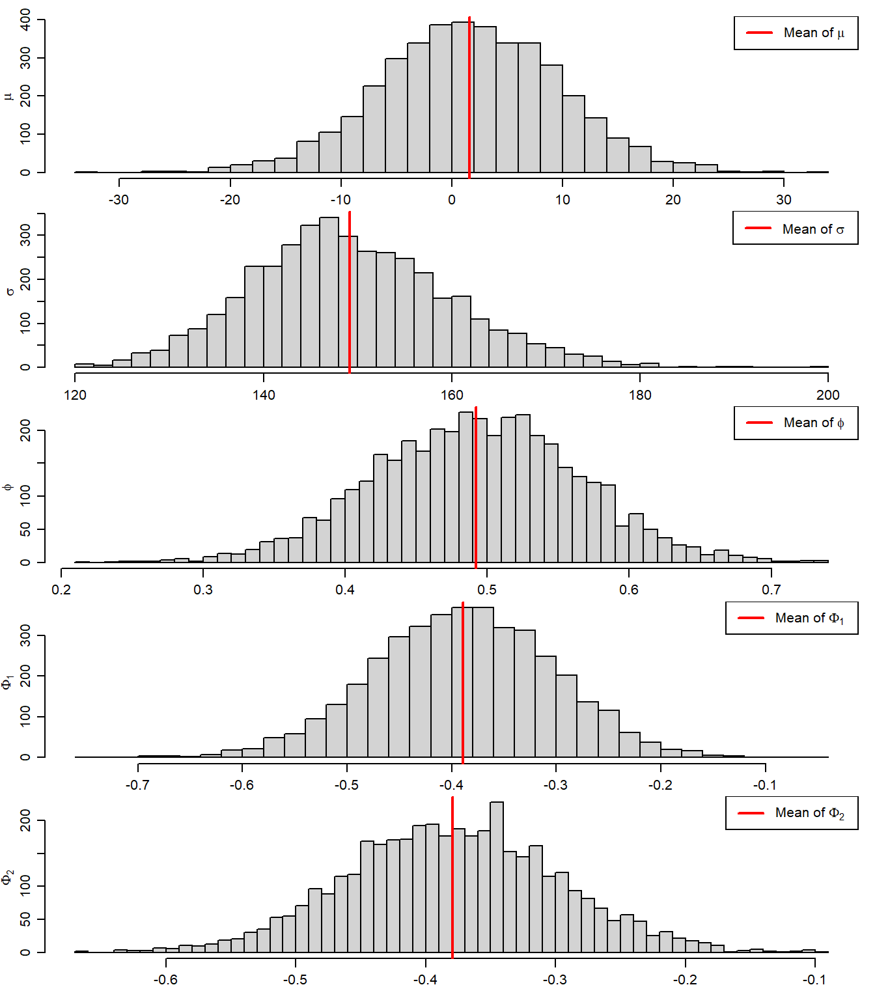
<p class="caption">(\#fig:buda-hist)Histograms of MCMC samples for parameters in Budapest series</p>
</div>

Although not strictly a convergence check, in Figure \@ref(fig:buda-hist), we can see that the posterior distributions look reasonable.

In Figure \@ref(fig:buda-diag-1), we can see that the ACF plots show negligible autocorrelation. Thinning is not required. In Figure \@ref(fig:buda-diag-2), the MCMC draws are all close to their areas of highest posterior density.


``` r
par(mfcol=c(5,1),mar=c(2,2.75,1,1),mgp=c(1.75,.75,0),oma=c(1.5,0,0,0))
# Autocorrelation
acf(data.buda$mu0,ylab=expression(mu),main="")
acf(data.buda$sigma,ylab=expression(sigma),main="")
acf(data.buda$ar,ylab=expression(phi),main="")
acf(data.buda$sar[,1],ylab=expression(Phi[1]),main="")
acf(data.buda$sar[,2],ylab=expression(Phi[2]),main="")
```

<div class="figure">
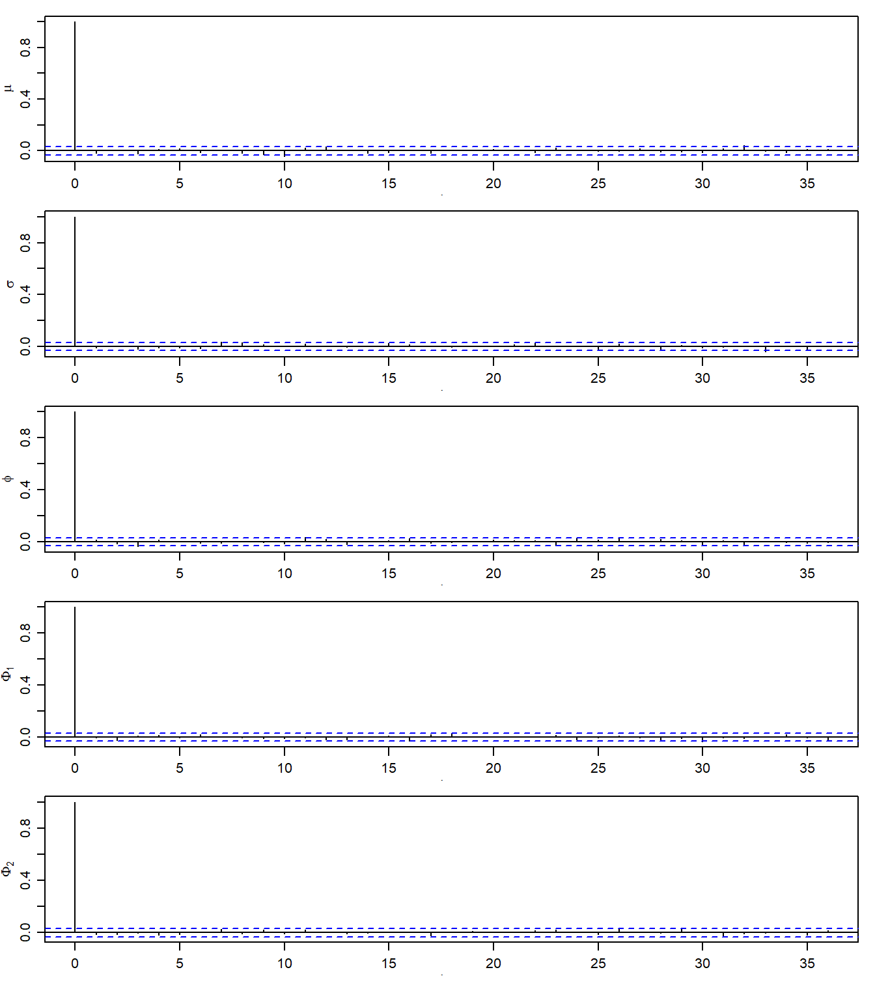
<p class="caption">(\#fig:buda-diag-1)ACF plots of MCMC samples for parameters in Budapest series</p>
</div>

``` r
# Traceplots
plot(data.buda$mu0,xlab="Iteration",ylab=expression(mu))
plot(data.buda$sigma,xlab="Iteration",ylab=expression(sigma))
plot(data.buda$ar,xlab="Iteration",ylab=expression(phi))
plot(data.buda$sar[,1],xlab="Iteration",ylab=expression(Phi[1]))
plot(data.buda$sar[,2],xlab="Iteration",ylab=expression(Phi[2]))
```

<div class="figure">
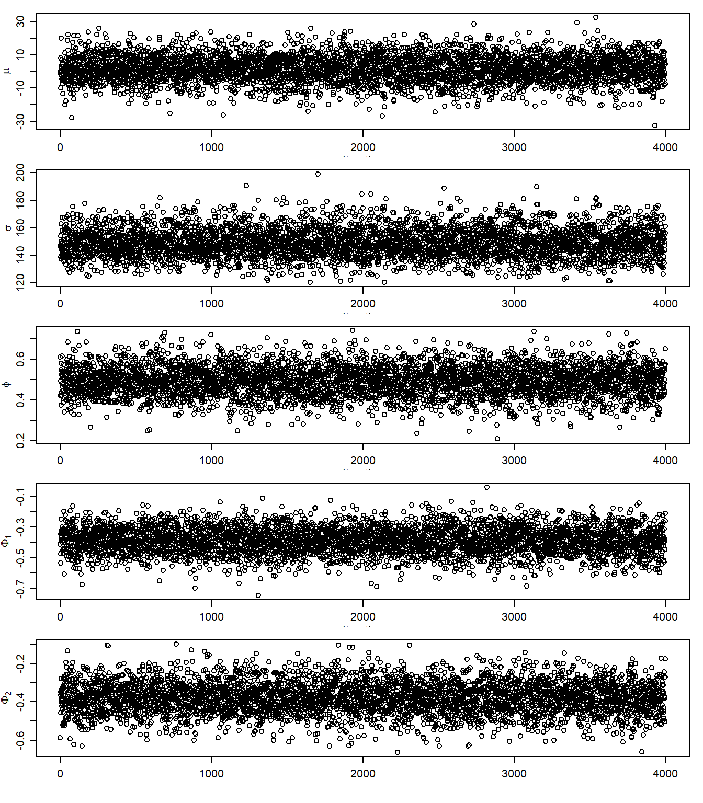
<p class="caption">(\#fig:buda-diag-2)Traceplots of MCMC samples for parameters in Budapest series</p>
</div>

Now, let us perform posterior predictive checks for a test statistic $T$. Let $x_{t}^{'}$ be the simulated series and $x_{t}$ be the original monthly series, as described in Section \@ref(ppc).

| $T$                                                                  | Identity | ACF  | PACF |
|:---------------------------------------------------------------------|---------:|-----:|-----:|
| $P\left( T\left( x_{t}^{'} \right) > T\left( x_{t} \right) \right)$  | 0.54     | 0.41 | 0.5  |

Table: (\#tab:buda-ppc) Posterior predictive p-values for Budapest series

In Table \@ref(tab:buda-ppc), we can see that the simulated series tends to match the original series quite well, particularly the magnitudes of the original series and the PACF. The ACF could be a little closer to 0.5, but we are also using a model fitted to 108 observations to predict the ACF values of the true 120 observation data set, so if we had only compared to the ACF values of the first 108 observations, the test statistic would likely be close to 0.5.

We can also plot histograms of the test statistics, but a quick check indicates that there is not any interesting behaviour and we cannot compare to a single mean value because the series values, ACF and PACF all consist of more than one value.

Overall, the convergence checks indicate that the MCMC chains for the Budapest fitting have converged and the posterior predictive checks indicate that the model does a good job at replicating the behaviour of the original series.

### Pest series {#pest}

The order fitted is $y_{t}|\mathbf{\gamma}\ \sim\ SARIMA(1,0,0)(0,1,1)_{12}$.

The results for the MCMC algorithm are displayed in Table \@ref(tab:pest-mcmc).

| Parameter    | Mean  | Standard error | 0.05 quantile | 0.95 quantile | ESS  | $\widehat{R}$ |
|:-------------|------:|---------------:|--------------:|--------------:|-----:|--------------:|
| $\mu$        | -2.5  | 0.1            | -9.2          | 4.4           | 3005 | 1             |
| $\sigma$     | 127.5 | 0.1            | 114.3         | 142.4         | 3923 | 1             |
| $\phi$       | 0.6   | 0              | 0.4           | 0.7           | 3688 | 1             |
| $\Theta_{1}$ | -0.7  | 0              | -0.9          | -0.6          | 3454 | 1             |

Table: (\#tab:pest-mcmc) Bayesian MCMC results for Pest series

The effective sample sizes are far greater than 1,000 and the $\widehat{R}$ values do not exceed 1 by any significant amount. Again, the large value for $\sigma$ and width of the 90% credible interval is not concerning. The intervals of the other ARIMA coefficients seem reasonable and do not include 0.

The Box-Cox transformation parameter was determined to be $\lambda \approx - 0.01$.


``` r
set.seed(1)

series = as.numeric(pest1$Cases)
series=ts(series,freq=season)
sf.pest = auto.sarima(ts = series,lambda=bc.lambda.pest,stepwise=FALSE,iter=itns,approximation=FALSE,prior_mu0=normal(0,10),prior_sigma0=cauchy(0,5),prior_ar=normal(0,2),prior_ma=normal(0,2),prior_sar=normal(0,2),prior_sma=normal(0,2))
sf.pest
orders.pest=sf.pest$model
order.pest = c(orders.pest$p,orders.pest$d,orders.pest$q)
sorder.pest = c(orders.pest$P,orders.pest$D,orders.pest$Q)

# Rhat/Effective sample size
sum.pest = summary(sf.pest)

data.pest = extract_stan(sf.pest)
sum.pest[,1:4] = round(sum.pest[,1:4],1); sum.pest$ess=round(sum.pest$ess); sum.pest$Rhat=round(sum.pest$Rhat,2)
write_xlsx(data.frame(sum.pest), "data/pest.xlsx")
```


``` r
# Coefficients
mu = mean(data.pest$mu0); s = mean(data.pest$sigma0); ar1 = mean(data.pest$ar0)
sma1 = mean(data.pest$sma0[,1])

# Plots
par(mfcol=c(4,1),mar=c(1,2.75,1,1),mgp=c(1.75,.75,0),oma=c(1.5,0,0,0))
hist(data.pest$mu0,main="",breaks=45,ylab=expression(mu));abline(v=mu,col='red',lwd=2);legend("topright",expression(paste("Mean of ",mu,"  ")),lty=1,lwd=2,col='red')
hist(data.pest$sigma,main="",breaks=55,ylab=expression(sigma));abline(v=s,col='red',lwd=2);legend("topright",expression(paste("Mean of ",sigma,"  ")),lty=1,lwd=2,col='red')
hist(data.pest$ar,main="",breaks=45,ylab=expression(phi));abline(v=ar1,col='red',lwd=2);legend("topright",expression(paste("Mean of ",phi,"  ")),lty=1,lwd=2,col='red')
hist(data.pest$sma[,1],main="",breaks=45,ylab=expression(Theta[1]));abline(v=sma1,col='red',lwd=2);legend("topright",expression(paste("Mean of ",Theta[1],"  ")),lty=1,lwd=2,col='red')
```

<div class="figure">
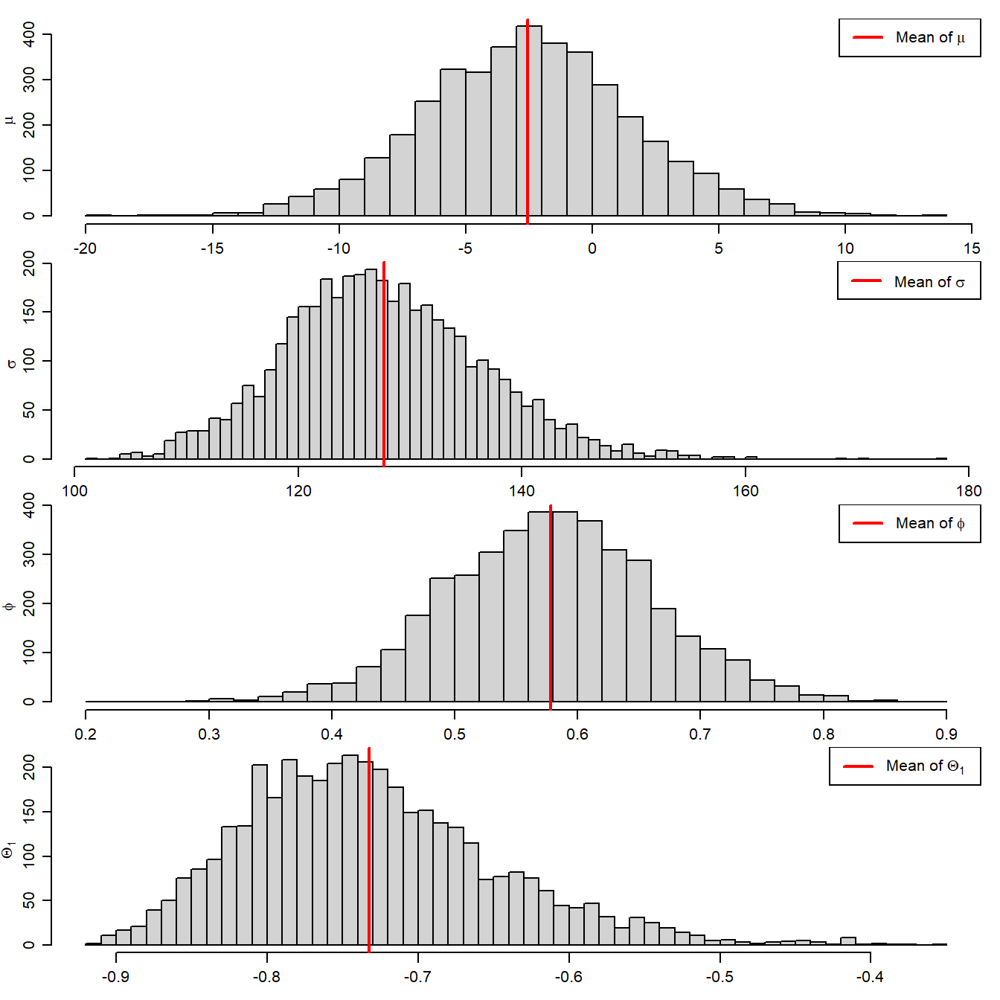
<p class="caption">(\#fig:pest-hist)Histograms of MCMC samples for parameters in Pest series</p>
</div>

In Figure \@ref(fig:pest-hist), we can see that the posterior distributions look reasonably well-behaved. In Figure \@ref(fig:pest-diag-1), we can see that the ACF plots show negligible autocorrelation. Thinning is not required. In Figure \@ref(fig:pest-diag-2), the MCMC draws are all close to their areas of highest posterior density.


``` r
par(mfcol=c(4,1),mar=c(2,2.75,1,1),mgp=c(1.75,.75,0),oma=c(1.5,0,0,0))
# Autocorrelation
acf(data.pest$mu0,ylab=expression(mu),main="")
acf(data.pest$sigma,ylab=expression(sigma),main="")
acf(data.pest$ar,ylab=expression(phi),main="")
acf(data.pest$sma[,1],ylab=expression(Theta[1]),main="")
```

<div class="figure">
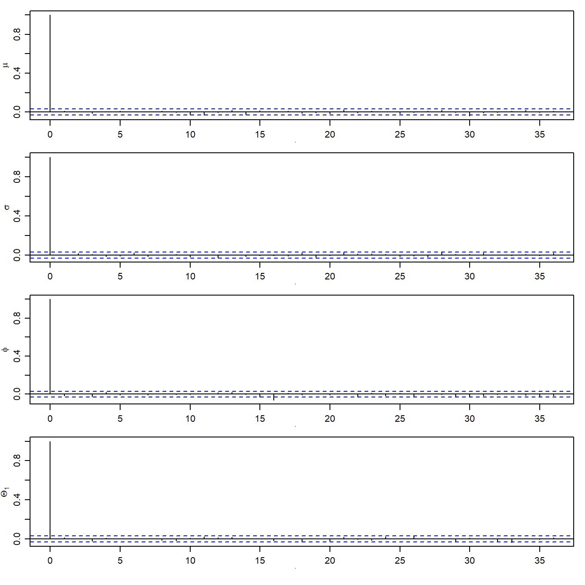
<p class="caption">(\#fig:pest-diag-1)ACF plots of MCMC samples for parameters in Pest series</p>
</div>

``` r
# Traceplots
plot(data.pest$mu0,xlab="Iteration",ylab=expression(mu))
plot(data.pest$sigma,xlab="Iteration",ylab=expression(sigma))
plot(data.pest$ar,xlab="Iteration",ylab=expression(phi))
plot(data.pest$sma[,1],xlab="Iteration",ylab=expression(Theta[1]))
```

<div class="figure">
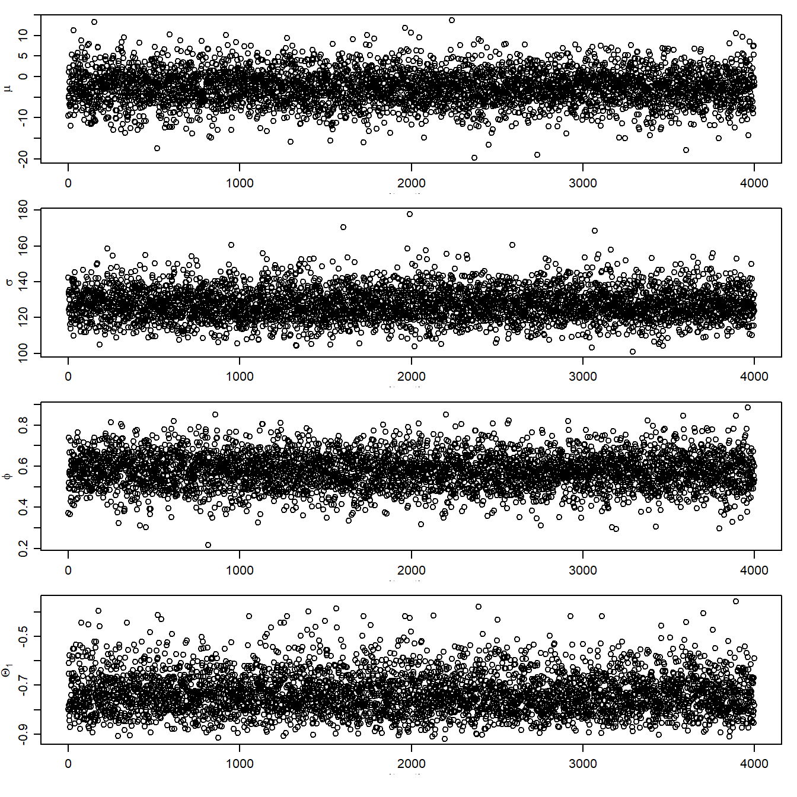
<p class="caption">(\#fig:pest-diag-2)Traceplots of MCMC samples for parameters in Pest series</p>
</div>

Now, let us perform posterior predictive checks for a test statistic $T$. Let $x_{t}^{'}$ be the simulated series and $x_{t}$ be the original monthly series, as described in Section \@ref(ppc).

| $T$                                                                  | Identity | ACF  | PACF |
|:---------------------------------------------------------------------|---------:|-----:|-----:|
| $P\left( T\left( x_{t}^{'} \right) > T\left( x_{t} \right) \right)$  | 0.52     | 0.44 | 0.52 |

Table: (\#tab:pest-ppc) Posterior predictive p-values for Pest series

In Table \@ref(tab:pest-ppc), we can see that the simulated series tends to match the original series quite well, particularly the magnitudes of the original series and the PACF. The ACF fits better than the Budapest series. This is a good result given we are using 108 observations in our model and comparing to a 120-observation series.

Overall, the convergence checks indicate that the MCMC chains for the Pest fitting have converged and the posterior predictive checks indicate that the model does a good job at replicating the behaviour of the original series.

### Heves series {#heves}

The order fitted is $y_{t}|\mathbf{\gamma}\ \sim\ SARIMA(1,0,0)(0,1,2)_{12}$.

The results for the MCMC algorithm are displayed in Table \@ref(tab:heves-mcmc).

| Parameter    | Mean  | Standard error | 0.05 quantile | 0.95 quantile | ESS  | $\widehat{R}$ |
|:-------------|------:|---------------:|--------------:|--------------:|-----:|--------------:|
| $\mu$        | -2    | 0              | -6.9          | 2.9           | 3938 | 1             |
| $\sigma$     | 84.2  | 0.1            | 75.3          | 94.4          | 3864 | 1             |
| $\phi$       | 0.7   | 0              | 0.5           | 0.8           | 3838 | 1             |
| $\Theta_{1}$ | -0.8  | 0              | -1            | -0.6          | 3819 | 1             |
| $\Theta_{2}$ | 0.1   | 0              | -0.1          | 0.3           | 3797 | 1             |

Table: (\#tab:heves-mcmc) Bayesian MCMC results for Heves series

The effective sample sizes are far greater than 1,000 and the $\widehat{R}$ values do not exceed 1 by any significant amount. Again, the large value for $\sigma$ and width of the 90% credible interval is not concerning. The intervals of the other ARIMA coefficients seem reasonable and do not include 0, except for $\Theta_{2}$.

The Box-Cox transformation parameter was determined to be $\lambda \approx - 0.25$, the largest adjustment we have had to make for heteroskedasticity.


``` r
set.seed(1)
series = as.numeric(heves1$Cases)
series=ts(series,freq=season)
sf.heves = auto.sarima(ts = series,lambda=bc.lambda.heves,stepwise=FALSE,iter=itns,approximation=FALSE,prior_mu0=normal(0,10),prior_sigma0=cauchy(0,5),prior_ar=normal(0,2),prior_ma=normal(0,2),prior_sar=normal(0,2),prior_sma=normal(0,2))
sf.heves
orders.heves=sf.heves$model
order.heves = c(orders.heves$p,orders.heves$d,orders.heves$q)
sorder.heves = c(orders.heves$P,orders.heves$D,orders.heves$Q)

# Rhat/Effective sample size
sum.heves = summary(sf.heves)

data.heves = extract_stan(sf.heves)
sum.heves[,1:4] = round(sum.heves[,1:4],1); sum.heves$ess=round(sum.heves$ess); sum.heves$Rhat=round(sum.heves$Rhat,2)
write_xlsx(data.frame(sum.heves), "data/heves.xlsx")
```


``` r
# Coefficients
mu = mean(data.heves$mu0); s = mean(data.heves$sigma0); ar1 = mean(data.heves$ar0)
sma1 = mean(data.heves$sma0[,1]); sma2 = mean(data.heves$sma0[,2])

# Plots
par(mfcol=c(5,1),mar=c(1,2.75,1,1),mgp=c(1.75,.75,0),oma=c(1.5,0,0,0))
hist(data.heves$mu0,main="",breaks=45,ylab=expression(mu));abline(v=mu,col='red',lwd=2);legend("topright",expression(paste("Mean of ",mu,"  ")),lty=1,lwd=2,col='red')
hist(data.heves$sigma,main="",breaks=45,ylab=expression(sigma));abline(v=s,col='red',lwd=2);legend("topright",expression(paste("Mean of ",sigma,"  ")),lty=1,lwd=2,col='red')
hist(data.heves$ar,main="",breaks=45,ylab=expression(phi));abline(v=ar1,col='red',lwd=2);legend("topright",expression(paste("Mean of ",phi,"  ")),lty=1,lwd=2,col='red')
hist(data.heves$sma[,1],main="",breaks=48,ylab=expression(Theta[1]));abline(v=sma1,col='red',lwd=2);legend("topright",expression(paste("Mean of ",Theta[1],"  ")),lty=1,lwd=2,col='red')
hist(data.heves$sma[,2],main="",breaks=56,ylab=expression(Theta[2]));abline(v=sma2,col='red',lwd=2);legend("topright",expression(paste("Mean of ",Theta[2],"  ")),lty=1,lwd=2,col='red')
```

<div class="figure">
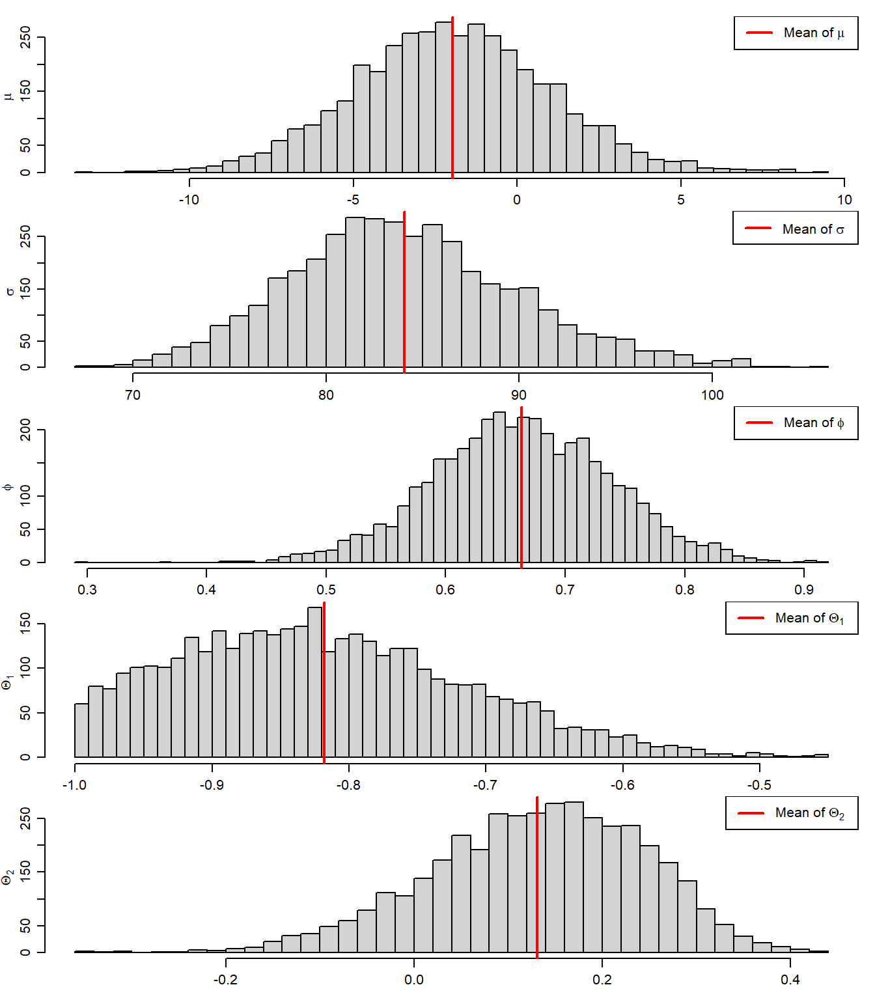
<p class="caption">(\#fig:heves-hist)Histograms of MCMC samples for parameters in Heves series</p>
</div>

In Figure \@ref(fig:heves-hist), we can see that the posterior distributions look reasonably well-behaved, although the posterior distribution for $\Theta_{1}$ exhibits a non-symmetry that we have not seen before. This series is probably the most complicated due to the presence of potential outliers which I decided not to remove.


``` r
par(mfcol=c(5,1),mar=c(2,2.75,1,1),mgp=c(1.75,.75,0),oma=c(1.5,0,0,0))
# Autocorrelation
acf(data.heves$mu0,ylab=expression(mu),main="")
acf(data.heves$sigma,ylab=expression(sigma),main="")
acf(data.heves$ar,ylab=expression(phi),main="")
acf(data.heves$sma[,1],ylab=expression(Theta[1]),main="")
acf(data.heves$sma[,2],ylab=expression(Theta[2]),main="")
```

<div class="figure">
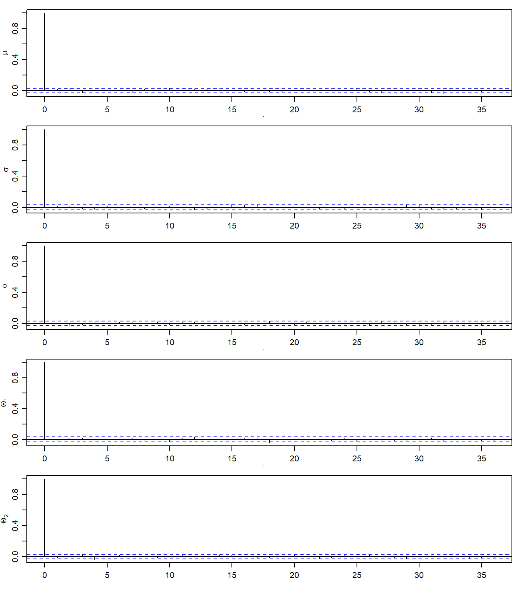
<p class="caption">(\#fig:heves-diag-1)ACF plots of MCMC samples for parameters in Heves series</p>
</div>

``` r
# Traceplots
plot(data.heves$mu0,xlab="Iteration",ylab=expression(mu))
plot(data.heves$sigma,xlab="Iteration",ylab=expression(sigma))
plot(data.heves$ar,xlab="Iteration",ylab=expression(phi))
plot(data.heves$sma[,1],xlab="Iteration",ylab=expression(Theta[1]))
plot(data.heves$sma[,2],xlab="Iteration",ylab=expression(Theta[2]))
```

<div class="figure">
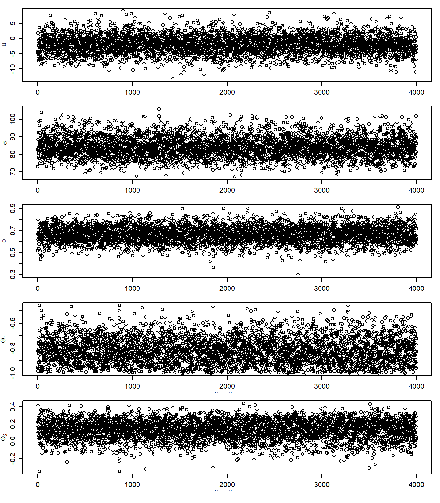
<p class="caption">(\#fig:heves-diag-2)Traceplots of MCMC samples for parameters in Heves series</p>
</div>

In Figure \@ref(fig:heves-diag-1), we can see that the ACF plots show negligible autocorrelation. Thinning is not required. In Figure \@ref(fig:heves-diag-2), the MCMC draws are all close to their areas of highest posterior density.

Now, let us perform posterior predictive checks for a test statistic $T$. Let $x_{t}^{'}$ be the simulated series and $x_{t}$ be the original monthly series, as described in Section \@ref(ppc).

| $T$                                                                  | Identity | ACF  | PACF |
|:---------------------------------------------------------------------|---------:|-----:|-----:|
| $P\left( T\left( x_{t}^{'} \right) > T\left( x_{t} \right) \right)$  | 0.55     | 0.37 | 0.44 |

Table: (\#tab:heves-ppc) Posterior predictive p-values for Heves series

In Table \@ref(tab:heves-ppc), we can see that the simulated series tends to match the original series quite well in terms of magnitude. The PACF values also correspond reasonably well, but the ACF p-value is a little low. Nevertheless, this is a good result given we are using 108 observations in our model and comparing to a 120-observation series.

Overall, the convergence checks indicate that the MCMC chains for the Heves fitting have converged and the posterior predictive checks indicate that the model does an acceptable job at replicating the behaviour of the original series. The histogram of samples of $\Theta_{1}$ appeared unusually non-symmetric, but the ACF and traceplot for this variable did not indicate anything to worry about. Nevertheless, instability in this coefficient may have contributed to the non-ideal ACF p-value. This series seems to be the most difficult to model out of the four we are studying.

### Somogy series {#somogy}

The order fitted is $y_{t}|\mathbf{\gamma}\ \sim\ SARIMA(0,0,2)(0,1,1)_{12}$.

The results for the MCMC algorithm are displayed in Table \@ref(tab:somogy-mcmc).

| Parameter    | Mean  | Standard error | 0.05 quantile | 0.95 quantile | ESS  | $\widehat{R}$ |
|:-------------|------:|---------------:|--------------:|--------------:|-----:|--------------:|
| $\mu$        | -4.6  | 0.1            | -14.3         | 5.7           | 3817 | 1             |
| $\sigma$     | 59.4  | 0.1            | 53.3          | 66.4          | 4118 | 1             |
| $\theta_{1}$ | 0.5   | 0              | 0.3           | 0.6           | 3478 | 1             |
| $\theta_{2}$ | 0.2   | 0              | 0.1           | 0.4           | 3559 | 1             |
| $\Theta_{1}$ | -0.4  | 0              | -0.6          | -0.3          | 3081 | 1             |

Table: (\#tab:somogy-mcmc) Bayesian MCMC results for Somogy series

The effective sample sizes are far greater than 1,000 and the $\widehat{R}$ values do not exceed 1 by any significant amount. Again, the large value for $\sigma$ and width of the 90% credible interval is not concerning. The intervals of the other ARIMA coefficients seem reasonable and do not include 0.

Interestingly, this series is the only one with a non-seasonal MA component and the only one that lacks a non-seasonal AR component, indicating a lack of dependence on the case numbers from the month prior compared to the other series.

The Box-Cox transformation parameter was determined to be $\lambda \approx - 0.18$, less than the Heves series, but still larger in magnitude than Budapest or Pest.

In Figure \@ref(fig:somogy-hist), we can see that the posterior distributions look reasonably well-behaved. In Figure \@ref(fig:somogy-diag-1), we can see that the ACF plots show negligible autocorrelation. Thinning is not required. In Figure \@ref(fig:somogy-diag-2), the MCMC draws are all close to their areas of highest posterior density.


``` r
set.seed(1)

series = as.numeric(somogy1$Cases)
series=ts(series,freq=season)
sf.somogy = auto.sarima(ts = series,lambda=bc.lambda.somogy,stepwise=FALSE,iter=itns,approximation=FALSE,prior_mu0=normal(0,10),prior_sigma0=cauchy(0,5),prior_ar=normal(0,2),prior_ma=normal(0,2),prior_sar=normal(0,2),prior_sma=normal(0,2))
sf.somogy
orders.somogy=sf.somogy$model
order.somogy = c(orders.somogy$p,orders.somogy$d,orders.somogy$q)
sorder.somogy = c(orders.somogy$P,orders.somogy$D,orders.somogy$Q)

# Rhat/Effective sample size
sum.somogy = summary(sf.somogy)

data.somogy = extract_stan(sf.somogy)
sum.somogy[,1:4] = round(sum.somogy[,1:4],1); sum.somogy$ess=round(sum.somogy$ess); sum.somogy$Rhat=round(sum.somogy$Rhat,2)
write_xlsx(data.frame(sum.somogy), "data/somogy.xlsx")
```


``` r
# Coefficients
mu = mean(data.somogy$mu0); s = mean(data.somogy$sigma0); ma1 = mean(data.somogy$ma0[,1])
ma2 = mean(data.somogy$ma0[,2]); sma1 = mean(data.somogy$sma0[,1])

# Plots
par(mfcol=c(5,1),mar=c(1,2.75,1,1),mgp=c(1.75,.75,0),oma=c(1.5,0,0,0))
hist(data.somogy$mu0,main="",breaks=45,ylab=expression(mu));abline(v=mu,col='red',lwd=2);legend("topright",expression(paste("Mean of ",mu,"  ")),lty=1,lwd=2,col='red')
hist(data.somogy$sigma,main="",breaks=40,ylab=expression(sigma));abline(v=s,col='red',lwd=2);legend("topright",expression(paste("Mean of ",sigma,"  ")),lty=1,lwd=2,col='red')
hist(data.somogy$ma[,1],main="",breaks=45,ylab=expression(theta[1]));abline(v=ma1,col='red',lwd=2);legend("topright",expression(paste("Mean of ",theta[1],"  ")),lty=1,lwd=2,col='red')
hist(data.somogy$ma[,2],main="",breaks=45,ylab=expression(theta[2]));abline(v=ma2,col='red',lwd=2);legend("topright",expression(paste("Mean of ",theta[2],"  ")),lty=1,lwd=2,col='red')
hist(data.somogy$sma[,1],main="",breaks=45,ylab=expression(Theta[1]));abline(v=sma1,col='red',lwd=2);legend("topright",expression(paste("Mean of ",Theta[1],"  ")),lty=1,lwd=2,col='red')
```

<div class="figure">
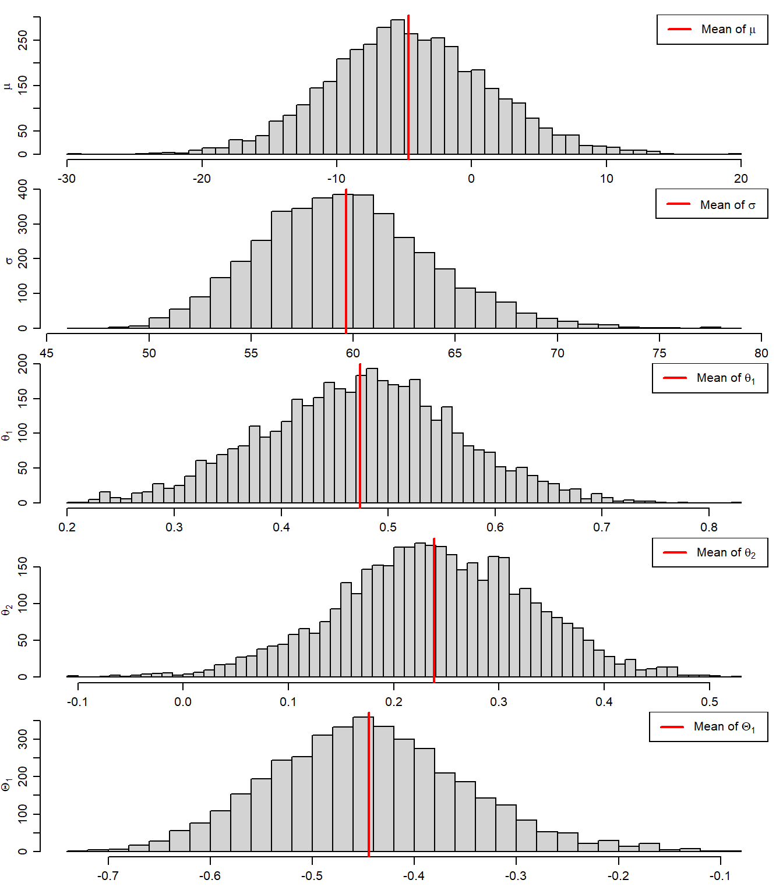
<p class="caption">(\#fig:somogy-hist)Histograms of MCMC samples for parameters in Somogy series</p>
</div>


``` r
par(mfcol=c(5,1),mar=c(2,2.75,1,1),mgp=c(1.75,.75,0),oma=c(1.5,0,0,0))
# Autocorrelation
acf(data.somogy$mu0,ylab=expression(mu),main="")
acf(data.somogy$sigma,ylab=expression(sigma),main="")
acf(data.somogy$ma[,1],ylab=expression(theta[1]),main="")
acf(data.somogy$ma[,2],ylab=expression(theta[2]),main="")
acf(data.somogy$sma[,1],ylab=expression(Theta[1]),main="")
```

<div class="figure">
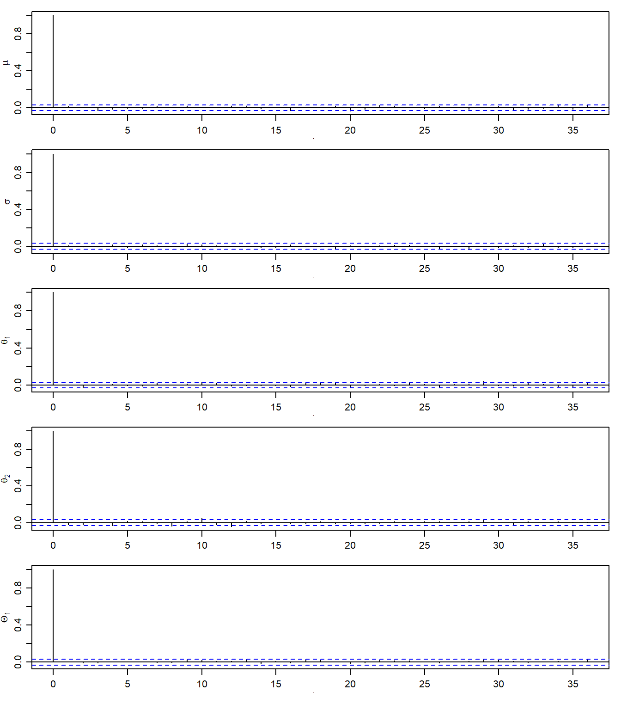
<p class="caption">(\#fig:somogy-diag-1)ACF plots of MCMC samples for parameters in Somogy series</p>
</div>

``` r
# Traceplots
plot(data.somogy$mu0,xlab="Iteration",ylab=expression(mu))
plot(data.somogy$sigma,xlab="Iteration",ylab=expression(sigma))
plot(data.somogy$ma[,1],xlab="Iteration",ylab=expression(theta[1]))
plot(data.somogy$ma[,2],xlab="Iteration",ylab=expression(theta[2]))
plot(data.somogy$sma[,1],xlab="Iteration",ylab=expression(Theta[1]))
```

<div class="figure">
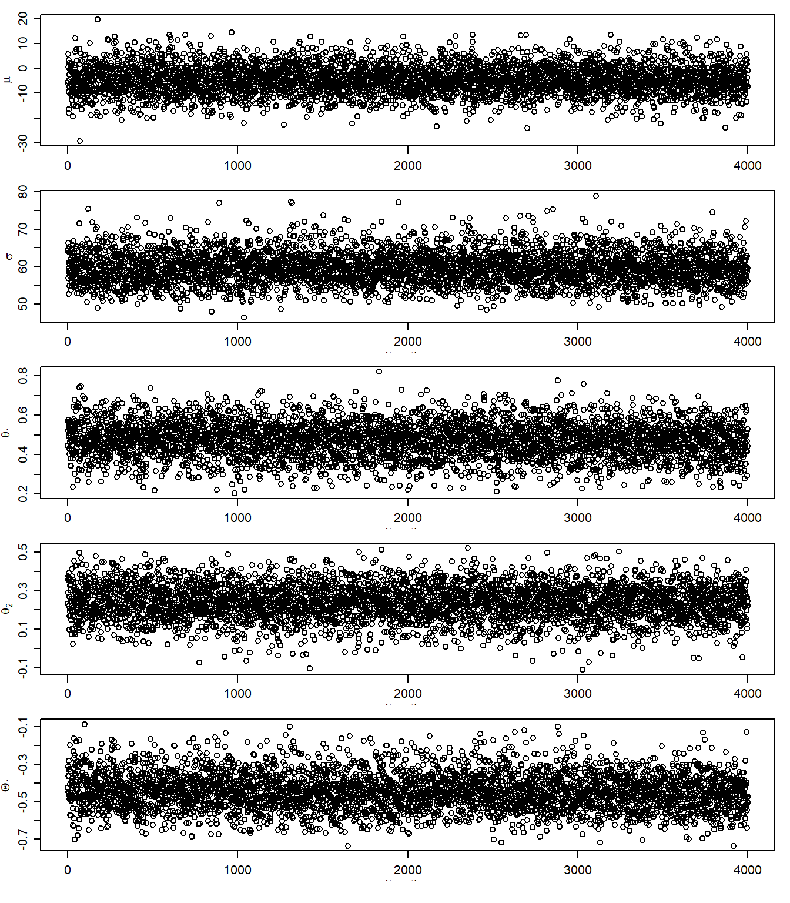
<p class="caption">(\#fig:somogy-diag-2)Traceplots of MCMC samples for parameters in Somogy series</p>
</div>

Now, let us perform posterior predictive checks for a test statistic $T$. Let $x_{t}^{'}$ be the simulated series and $x_{t}$ be the original monthly series, as described in Section \@ref(ppc).

| $T$                                                                  | Identity | ACF  | PACF |
|:---------------------------------------------------------------------|---------:|-----:|-----:|
| $P\left( T\left( x_{t}^{'} \right) > T\left( x_{t} \right) \right)$  | 0.58     | 0.46 | 0.51 |

Table: (\#tab:somogy-ppc) Posterior predictive p-values for Somogy series

In Table \@ref(tab:somogy-ppc), we can see that the simulated series tends to match the original series quite well in terms of the ACF and PACF values. The p-value directly comparing the magnitudes of the simulated series to the original series is a little high. Nevertheless, this is a good result given we are using 108 observations in our model and comparing to a 120-observation series.

Overall, the convergence checks indicate that the MCMC chains for the Somogy fitting have converged and the posterior predictive checks indicate that the model does a good job at replicating the behaviour of the original series.

## Residual checks and other non-Bayesian diagnostics {#residual-checks}

A standard non-Bayesian check is to ensure that the residuals behave as white noise and are uncorrelated.


``` r
res.buda=residuals(sf.buda);res.pest=residuals(sf.pest)
res.heves=residuals(sf.heves);res.somogy=residuals(sf.somogy)

par(mfcol=c(4,1),mar=c(1,2.75,1,1),mgp=c(1.75,.75,0),oma=c(1.5,0,0,0))
plot(res.buda,ylab="Budapest",type='o'); abline(h=0,lty=2,col='grey')
plot(res.pest,ylab="Pest",type='o'); abline(h=0,lty=2,col='grey')
plot(res.heves,ylab="Heves",type='o'); abline(h=0,lty=2,col='grey')
plot(res.somogy,ylab="Somogy",type='o'); abline(h=0,lty=2,col='grey')
```

<div class="figure">
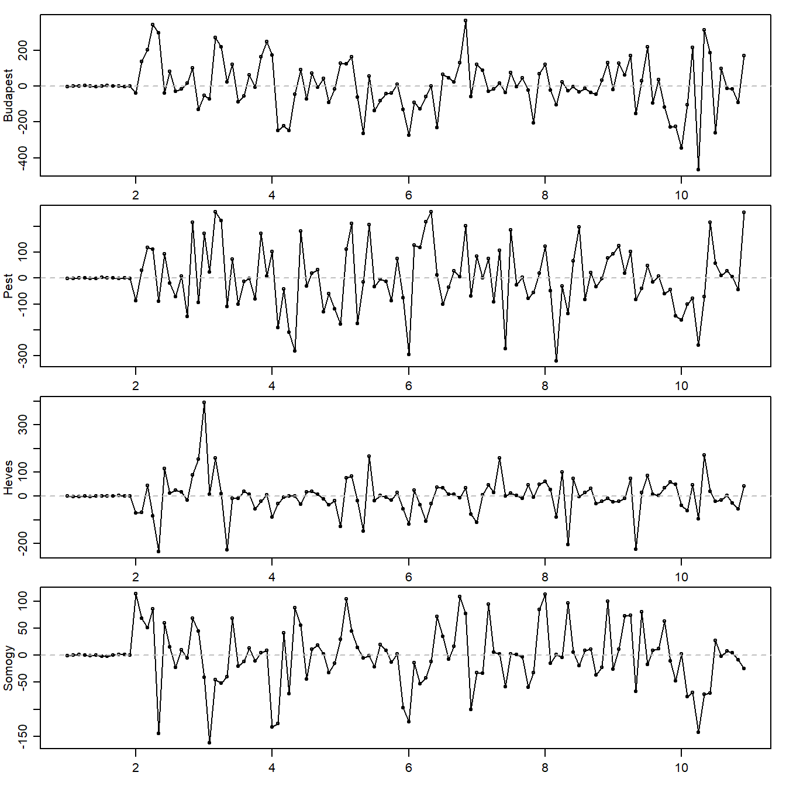
<p class="caption">(\#fig:resid-plot)Residual plots for the fitted time series models</p>
</div>

In Figure \@ref(fig:resid-plot), we can see that the first 12 observations are considered fixed in the models. (The derivation in Section \@ref(sampling-model) assumes the most complicated case where 36 observations are fixed, but each of these fittings is a subset of the most complex case.) The rest of the plots are mostly centred at 0 and look reasonable, except some non-constant variance towards the end of the Budapest series, in the middle of the Pest series and potentially at some parts of the Somogy series.


``` r
par(mfcol=c(4,1),mar=c(2,2.75,1,1),mgp=c(1.75,.75,0),oma=c(1.5,0,0,0))
acf(res.buda,ylab="Budapest",main="")
acf(res.pest,ylab="Pest",main="")
acf(res.heves,ylab="Heves",main="")
acf(res.somogy,ylab="Somogy",main="")
```

<div class="figure">
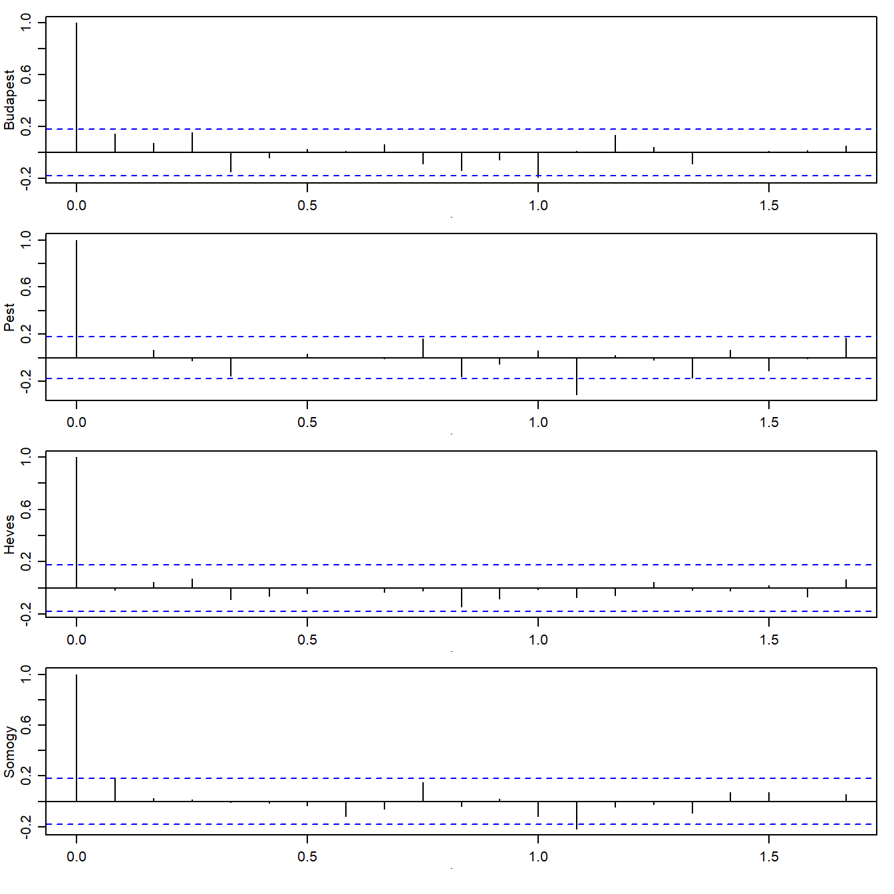
<p class="caption">(\#fig:resid-acf-1)ACF plots for the residuals of the fitted time series models</p>
</div>

``` r
pacf(res.buda,ylab="Budapest",main="")
pacf(res.pest,ylab="Pest",main="")
pacf(res.heves,ylab="Heves",main="")
pacf(res.somogy,ylab="Somogy",main="")
```

<div class="figure">
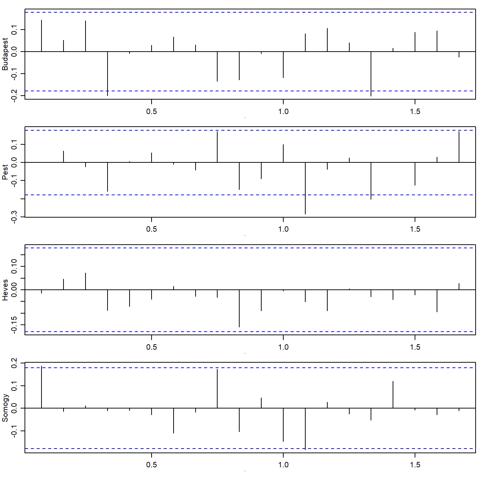
<p class="caption">(\#fig:resid-acf-2)PACF plots for the residuals of the fitted time series models</p>
</div>

In Figure \@ref(fig:resid-acf-1), the ACF plots do not show any significant departures from being white noise, although Somogy and Pest do have one or two observations exceeding the threshold. In Figure \@ref(fig:resid-acf-2), some PACF values for Pest and to a lesser extent Budapest should be a little smaller, but overall it may be acceptable.


``` r
par(mfrow=c(2,2),pty="s")
qqnorm(res.buda,main="",ylab="Budapest");qqline(res.buda)
qqnorm(res.pest,main="",ylab="Pest");qqline(res.pest)
qqnorm(res.heves,main="",ylab="Heves");qqline(res.heves)
qqnorm(res.somogy,main="",ylab="Somogy");qqline(res.somogy)
```

<div class="figure">
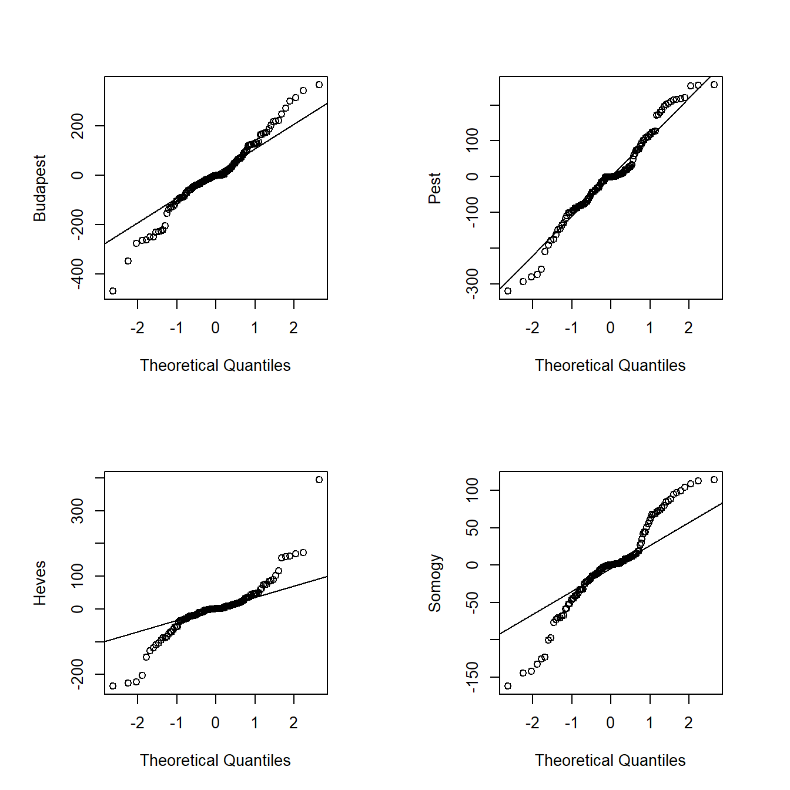
<p class="caption">(\#fig:qq-plot)Q-Q plots for the residuals of the fitted time series models</p>
</div>


``` r
par(mfcol=c(4,1),mar=c(1,2.75,1,1),mgp=c(1.75,.75,0),oma=c(1.5,0,0,0))
fitted.buda = as.numeric(fitted(sf.buda)); fitted.buda = ifelse(fitted.buda>0,fitted.buda,0)
fitted.buda = ts(fitted.buda,freq=season,start=2005)
ylimrange = range(c(as.numeric(plot.buda),as.numeric(fitted.buda)));ylimrange[2]=ylimrange[2]
plot(plot.buda,xaxt = "n",ylim=ylimrange,type='l',ylab="Budapest",main="")
lines(fitted.buda,col='red',type='o',lty=2); legend("topright",c("True","Fitted"),lty=c(1,3),col=c('black','red'))

fitted.pest = as.numeric(fitted(sf.pest)); fitted.pest = ifelse(fitted.pest>0,fitted.pest,0)
fitted.pest = ts(fitted.pest,freq=season,start=2005)
ylimrange = range(c(as.numeric(plot.pest),as.numeric(fitted.pest)));ylimrange[2]=ylimrange[2]
plot(plot.pest,xaxt = "n",ylim=ylimrange,type='l',ylab="Pest",main="")
lines(fitted.pest,col='red',type='o',lty=2); legend("topright",c("True","Fitted"),lty=c(1,3),col=c('black','red'))

fitted.heves = as.numeric(fitted(sf.heves)); fitted.heves = ifelse(fitted.heves>0,fitted.heves,0)
fitted.heves = ts(fitted.heves,freq=season,start=2005)
ylimrange = range(c(as.numeric(plot.heves),as.numeric(fitted.heves)));ylimrange[2]=ylimrange[2]
plot(plot.heves,xaxt = "n",ylim=ylimrange,type='l',ylab="Heves",main="")
lines(fitted.heves,col='red',type='o',lty=2); legend("topright",c("True","Fitted"),lty=c(1,3),col=c('black','red'))

fitted.somogy = as.numeric(fitted(sf.somogy)); fitted.somogy = ifelse(fitted.somogy>0,fitted.somogy,0)
fitted.somogy = ts(fitted.somogy,freq=season,start=2005)
ylimrange = range(c(as.numeric(plot.somogy),as.numeric(fitted.somogy)));ylimrange[2]=ylimrange[2]
plot(plot.somogy,xaxt = "n",ylim=ylimrange,type='l',ylab="Somogy",main="")
dates = as.Date(somogy1$Month); sequence = attributes(plot.somogy)$tsp
axis(1, at = seq(sequence[1], sequence[2], along = plot.somogy), labels = format(dates, "%Y-%m"))
lines(fitted.somogy,col='red',type='o',lty=2); legend("topright",c("True","Fitted"),lty=c(1,3),col=c('black','red'))
```

<div class="figure">
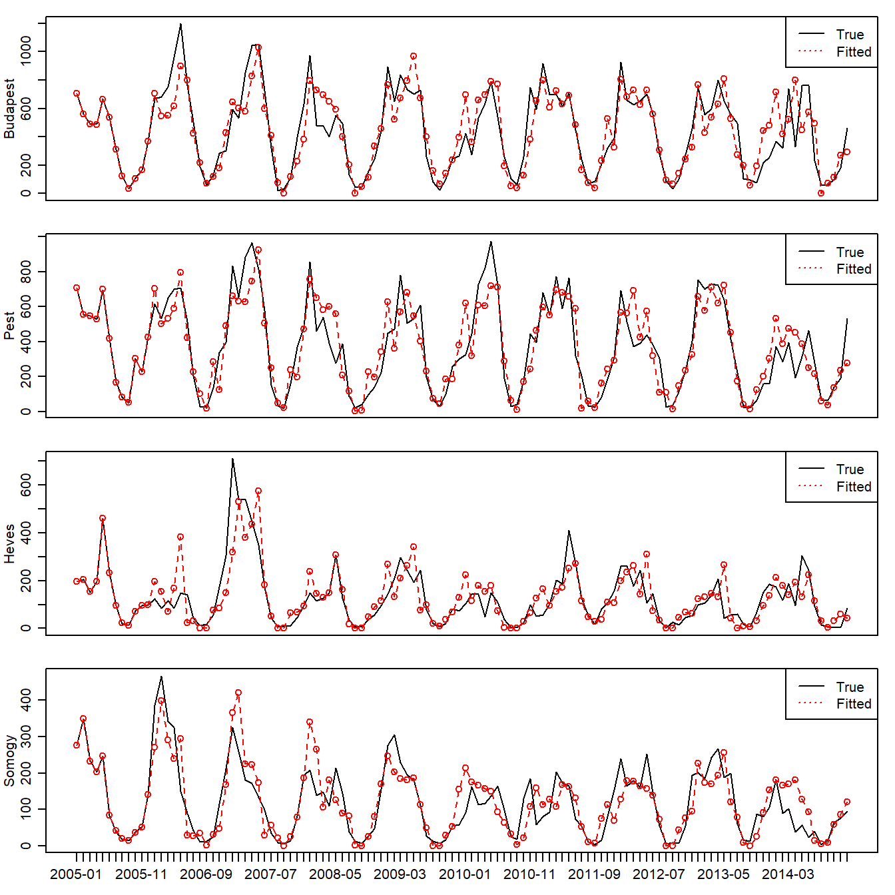
<p class="caption">(\#fig:fitted-plot)Fitted values against the original data</p>
</div>

In Figure \@ref(fig:qq-plot), the Q-Q plots all indicate heavier tails compared to the Normal distribution. This may make confidence intervals based on normal distributions less accurate, but does not affect the point estimates. There are other ways around this to create confidence intervals, such as bootstrapping (Hyndman & Athanasopoulos, 2021).

In Figure \@ref(fig:fitted-plot), the fitted time series show a reasonable fit to the original data. At least the first 12 observations are assumed in the model (see Section \@ref(sampling-model)) and for most of the plots, the rest of the fit is not too far from the observed values. This indicates that the fittings are reasonable.


``` r
fc.buda = bayesforecast::forecast(sf.buda,h=12)
fc.pest = bayesforecast::forecast(sf.pest,h=12)
fc.heves = bayesforecast::forecast(sf.heves,h=12)
fc.somogy = bayesforecast::forecast(sf.somogy,h=12)

lower80.buda = fc.buda$lower[,1]; upper80.buda = fc.buda$upper[,1]
plot.fc.buda = ts(as.numeric(fc.buda$mean),freq=season,start=2014)
lower80.pest = fc.pest$lower[,1]; upper80.pest = fc.pest$upper[,1]
plot.fc.pest = ts(as.numeric(fc.pest$mean),freq=season,start=2014)
lower80.heves = fc.heves$lower[,1]; upper80.heves = fc.heves$upper[,1]
plot.fc.heves = ts(as.numeric(fc.heves$mean),freq=season,start=2014)
lower80.somogy = fc.somogy$lower[,1]; upper80.somogy = fc.somogy$upper[,1]
plot.fc.somogy = ts(as.numeric(fc.somogy$mean),freq=season,start=2014)

times = (length(plot.buda)-4*season):length(plot.buda)
dates = as.Date(somogy1$Month)[times]; sequence = attributes(plot.somogy)$tsp

par(mfcol=c(4,1),mar=c(1,2.75,1,1),mgp=c(1.75,.75,0),oma=c(1.5,0,0,0))
ylimrange = range(c(as.numeric(buda1$Cases)[times],as.numeric(fc.buda$mean),upper80.buda,lower80.buda))
plot(times,plot.buda[times],xaxt = "n",ylim=ylimrange,type='l',ylab="Budapest",main="")
lines((length(plot.buda)-test+1):length(plot.buda),as.numeric(plot.fc.buda),lty=2,type='o',col='red')
lines((length(plot.buda)-test+1):length(plot.buda),lower80.buda,lty=2,col='blue')
lines((length(plot.buda)-test+1):length(plot.buda),upper80.buda,lty=2,col='blue')
legend("topleft",c("True","Forecast","Interval"),lty=c(1,2,2),col=c('black','red','blue'))
ylimrange = range(c(as.numeric(pest1$Cases)[times],as.numeric(fc.pest$mean),upper80.pest,lower80.pest))
plot(times,plot.pest[times],xaxt = "n",ylim=ylimrange,type='l',ylab="Pest",main="")
lines((length(plot.pest)-test+1):length(plot.pest),as.numeric(plot.fc.pest),lty=2,type='o',col='red')
lines((length(plot.pest)-test+1):length(plot.pest),lower80.pest,lty=2,col='blue')
lines((length(plot.pest)-test+1):length(plot.pest),upper80.pest,lty=2,col='blue')
legend("topleft",c("True","Forecast","Interval"),lty=c(1,2,2),col=c('black','red','blue'))
ylimrange = range(c(as.numeric(heves1$Cases)[times],as.numeric(fc.heves$mean),upper80.heves,lower80.heves))
plot(times,plot.heves[times],xaxt = "n",ylim=ylimrange,type='l',ylab="Heves",main="")
lines((length(plot.heves)-test+1):length(plot.heves),as.numeric(plot.fc.heves),lty=2,type='o',col='red')
lines((length(plot.heves)-test+1):length(plot.heves),lower80.heves,lty=2,col='blue')
lines((length(plot.heves)-test+1):length(plot.heves),upper80.heves,lty=2,col='blue')
legend("topleft",c("True","Forecast","Interval"),lty=c(1,2,2),col=c('black','red','blue'))
ylimrange = range(c(as.numeric(somogy1$Cases)[times],as.numeric(fc.somogy$mean),upper80.somogy,lower80.somogy))
plot(times,plot.somogy[times],xaxt = "n",ylim=ylimrange,type='l',ylab="Somogy",main="")
lines((length(plot.somogy)-test+1):length(plot.somogy),as.numeric(plot.fc.somogy),lty=2,type='o',col='red')
lines((length(plot.somogy)-test+1):length(plot.somogy),lower80.somogy,lty=2,col='blue')
lines((length(plot.somogy)-test+1):length(plot.somogy),upper80.somogy,lty=2,col='blue')
legend("topleft",c("True","Forecast","Interval"),lty=c(1,2,2),col=c('black','red','blue'))
```

<div class="figure">
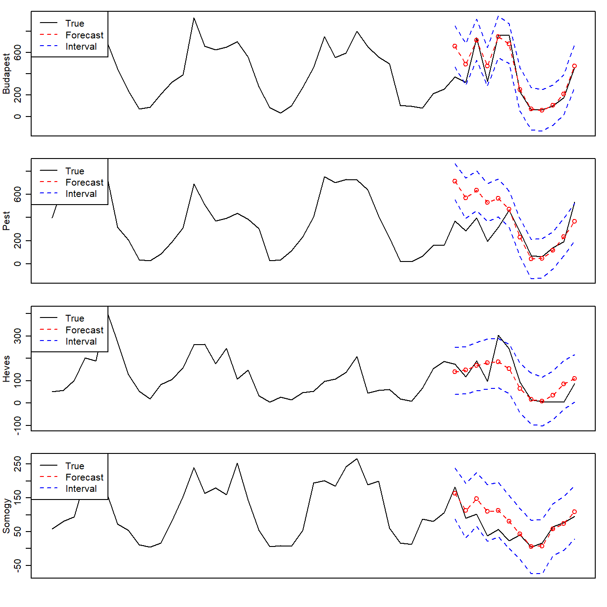
<p class="caption">(\#fig:forecast-plot)Plots of forecasted against original data</p>
</div>

In Figure \@ref(fig:forecast-plot), the forecasted values are shown against the last few years of data, including the final year. Notably, the Pest series departs considerably from its estimate, but the others look fine. As we determined earlier, we should not read too much into the confidence intervals as the Q-Q plots were heavy-tailed.

Overall, there are some slightly worrying issues about the fitting for the Pest series, but we may regard it as acceptable since had good posterior predictive check results.

# Discussion {#discussion}

In our research question, we are interested in studying how population density may lead to differences in the behaviour of chickenpox case numbers over time. Part of this process is to fit the best ARIMA models we can.

To interpret the meaning of the coefficients, the mean values of the coefficients are summarised in Table \@ref(tab:coefs), with a blank entry indicating that the model order did not include that parameter. Recall that phi terms correspond to AR and seasonal AR coefficients, while theta terms correspond to respective MA coefficients.

| Model    | $\mu$ | $\sigma$ | $\phi$ | $\theta_{1}$ | $\theta_{2}$ | $\Phi_{1}$ | $\Phi_{2}$ | $\Theta_{1}$ | $\Theta_{2}$ |
|:------------------|------:|---------:|-------:|-------------:|-------------:|-----------:|-----------:|-------------:|-------------:|
| Budapest | 1.7   | 149.1    | 0.5    |              |              | -0.4       | -0.4       |              |              |
| Pest     | -2.5  | 127.5    | 0.6    |              |              |            |            | -0.7         |              |
| Heves    | -2    | 84.2     | 0.7    |              |              |            |            | -0.8         | 0.1          |
| Somogy   | -4.6  | 59.4     |        | 0.5          | 0.2          |            |            | -0.4         |              |

Table: (\#tab:coefs) ARIMA coefficients for each series

It should be noted that all of the 90% credible intervals for $\mu$ included 0 and the size of $\mu$ is not large compared to the scale of actual cases which are often in the hundreds. The values of $\sigma$ are not of concern as it is not the focus of our research question. All of the ARIMA coefficients had fairly narrow 90% credible intervals, where the width of the intervals was at most about 0.4 and could be as small as 0.2. The only credible interval that included 0 was $\Theta_{2}$ for the Heves series.

Seasonality is certainly present in the time series and cases or forecast errors up to 24 months prior (in the same month of the year) can affect the current timestep.

We can interpret that the Budapest series has the strongest dependence on previous values of its series, both immediately prior and in the same month in previous years. All the series showed a dependence on the case numbers from the month prior, except for Somogy. The Budapest series was the only one that did not use past forecast errors, while Somogy was the only series that used past forecast errors from the months immediately prior.

Overall, we can see that these four regions that have the largest differences in population density behave quite differently, which suggests our research question has merit. Although the sample size in terms of the number of time series studied is small, we possibly see a sort of shift from AR and seasonal AR terms being important in regions of high population density to MA and seasonal MA terms playing a larger role in smaller population density regions. Seasonality clearly plays a factor here, as the shift from AR to MA terms occurs in both the seasonal and non-seasonal components.

# Conclusion {#conclusion}

My research question involved looking into the way population density affects the behaviour of chickenpox cases in Hungary. Four time series were chosen that were the farthest apart from each other in terms of population density.

Although we only studied a small number of time series, we did see that there was a clear difference in the order of ARIMA fitted moving from the highest population density series to the lowest population density series. This difference can be described as a shift from seasonal and non-seasonal AR coefficients to seasonal and non-seasonal MA coefficients. In other words, in our small sample, for higher population density regions, chickenpox cases were more dependent on chickenpox cases in previous periods or the same month in previous years, while the numbers for lower population regions were more dependent on seasonal and non-seasonal forecast errors. Seasonality, particularly the timing of school holidays, played a significant role in determining this effect.

One of the strengths of our analysis is that the ARIMA model fitting was Bayesian. Although we did not have a small data set, adapting the method used in this project for a much shorter time series would not be difficult and the results would likely be robust due to the structure provided by the prior distributions.

There are some limitations in this analysis. There appeared to be an issue in simulating some (but not all) series with MA parameters. This was easily fixed by repeatedly simulating until there are no *NA* values, but may indicate some other issues with my code. If I had more time, I would program my own ARIMA evaluation function rather than using the *forecast* package.

There are several extensions that could be suggested for this analysis. Though once the order was determined, we used a Bayesian method to fit the ARIMA model, the actual process for order selection was frequentist. In other words, the process exhaustively fitted models using frequentist estimation and compared the BIC of these values. It would be easy in principle to replace the frequentist estimation with Bayesian estimation, but this would be very time-consuming to run. Other model selection criteria could be used too, such as leave-one-out cross-validation.

There appeared to be a slight misfit for the Pest series in terms of forecast accuracy and residual checks. However, the ARIMA order was determined exhaustively using a frequentist method. It may be beneficial to investigate alternative orders to see if the Bayesian fitting could be improved.

Finally, another obvious extension is to study more than one series simultaneously using a vector autoregressive method or a hierarchical method.

# Appendices

## R packages

Used in setting up time series and preprocessing (some packaged used indirectly)
- fpp3 (Hyndman, 2021)
- tibble (Müller & Wickham, 2021)
- dplyr (Wickham, François, Henry & Müller, 2021)
- tidyr (Wickham, 2021)
- lubridate (Grolemund & Wickham, 2021)
- tsibble (Wang, Cook, & Hyndman, 2021)
- tsibbledata (O’Hara-Wild, Hyndman, & Wang, 2021d)
- feasts (O’Hara-Wild, Hyndman, & Wang, 2021c)
- fable (O’Hara-Wild, Hyndman, & Wang, 2021a)
- fabletools (O’Hara-Wild, Hyndman, & Wang, 2021b)
Bayesian fitting and simulations
- bayesforecast (Alonzo & Cruz, 2020)
- forecast (Athanasopoulos et al., 2021)
Saving data
- writexl (Ooms, 2021)

## Reference List

Alonzo, I., & Cruz, C. (2020). varstan: An R Package for Bayesian time series models with Stan. R 
         package version 1.0.1. Retrieved from https://CRAN.R-project.org/package=bayesforecast
Carpenter, B., Gelman, A., Hoffman, M. D., Lee, D., Goodrich, B., Betancourt, M., Brubaker, M., Guo, J., 
         Li, P., & Riddell, A. (2017). Stan: A probabilistic programming language. Journal of 
         Statistical Software, 76(1), 1-32. doi: 10.18637/jss.v076.i01.
University of California. (2021). Hungarian Chickenpox Cases Data Set [Data file]. Retrieved from 
         https://archive.ics.uci.edu/ml/datasets/Hungarian+Chickenpox+Cases
Edarabia. (2021). Hungary school holidays. Retrieved November 3, 2021, from 
         https://www.edarabia.com/school-holidays-hungary/
Grolemund, G., & Wickham, H. (2011). Dates and Times Made Easy with lubridate. Journal of Statistical 
         Software, 40(3), 1-25. doi: 10.18637/jss.v040.i03
Hungarian Central Statistical Office. (2019, January). Gazetteer of Hungary. Retrieved from 
         https://www.ksh.hu/
Hyndman, R.J. (2021). fpp3: Data for "Forecasting: Principles and Practice" (3rd Edition). R package 
         version 0.4.0. Retrieved from https://CRAN.R-project.org/package=fpp3
Hyndman, R.J., & Athanasopoulos, G. (2021). Forecasting: Principles and Practice (3rd ed.). Melbourne, 
         Australia: OTexts.
Hyndman, R.J., & Khandakar, Y. (2008). Automatic time series forecasting: The forecast package for R. 
         Journal of Statistical Software, 27(1), 1-22. doi: 10.18637/jss.v027.i03
Hyndman, R., Athanasopoulos, G., Bergmeir, C., Caceres, G., Chhay, L., O'Hara-Wild, M., Petropoulos, 
         F., Razbash. S., Wang, E., Yasmeen, F. (2021). forecast: Forecasting functions for time series and 
         linear models. R package version 8.15. Retrieved from https://CRAN.R-
         project.org/package=forecast
Meszner, Z., Molnar, Z., Rampakakis, E., Yang, H. K., Kuter, B. J., & Wolfson, L. J. (2017). Economic 
         burden of varicella in children 1-12 Years of age in Hungary, 2011-2015. BMC Infectious Diseases, 
         17(1), 495. doi: 10.1186/s12879-017-2575-6
Müller, K., & Wickham, H. (2021). tibble: Simple Data Frames. R package version 3.1.5. Retrieved from 
         https://CRAN.R-project.org/package=tibble
O'Hara-Wild, M., Hyndman, R.J., & Wang, E. (2021a). fable: Forecasting Models for Tidy Time Series. R 
         package version 0.3.1. Retrieved from https://CRAN.R-project.org/package=fable
O'Hara-Wild, M., Hyndman, R.J., & Wang, E. (2021b). fabletools: Core Tools for Packages in the 'fable' Framework. R package version 0.3.1. https://CRAN.R-project.org/package=fabletools
O'Hara-Wild, M., Hyndman, R.J., & Wang, E. (2021c). feasts: Feature Extraction and Statistics for Time 
         Series. R package version 0.2.2. Retrieved from https://CRAN.R-project.org/package=feasts
O'Hara-Wild, M., Hyndman, R.J., & Wang, E. (2021d). tsibbledata: Diverse Datasets for 'tsibble'. R 
         package  version 0.3.0. Retrieved from https://CRAN.R-project.org/package=tsibbledata
Ooms, J. (2021). writexl: Export Data Frames to Excel 'xlsx' Format. R package version 1.4.0. Retrieved 
         from https://CRAN.R-project.org/package=writexl
Rozemberczki, B., Scherer, P., Kiss, O., Sarkar, R., & Ferenci, T. (2021). Chickenpox Cases in Hungary: 
         a Benchmark Dataset for Spatiotemporal Signal Processing with Graph Neural Networks. Retrieved 
         from The University of Edinburgh, College of Science and Engineering website: 
         https://www.research.ed.ac.uk/en/publications/chickenpox-cases-in-hungary-a-benchmark-dataset-
         for-spatiotempora
R Core Team. (2021). R: A Language and Environment for Statistical Computing. Vienna, Austria. 
         Retrieved from https://www.R-project.org/
RStudio Team (2021). RStudio: Integrated Development for R. RStudio. Boston, MA. Retrieved from 
         http://www.rstudio.com/
Stan Development Team. (2021). Stan Modeling Language Users Guide and Reference Manual, Version 
         2.28. Retrieved from https://mc-stan.org
The Pharma Letter. (2018, March 12). Hungary to provide chickenpox vaccine free of charge from next 
         January. The Pharma Letter. Retrieved from http://www.thepharmaletter.com
Wang, E., Cook, D., & Hyndman, R.J. (2020). A new tidy data structure to support exploration and 
         modeling of temporal data, Journal of Computational and Graphical Statistics,  29(3), 466-478. 
         doi:10.1080/10618600.2019.1695624.
Wickham, H. (2021). tidyr: Tidy Messy Data. R package version 1.1.4. Retrieved from https://CRAN.R-
         project.org/package=tidyr
Wickham, H., François, R., Henry, L., & Müller, K. (2021). dplyr: A Grammar of Data Manipulation. R 
         package version 1.0.7. Retrieved from https://CRAN.R-project.org/package=dplyr
