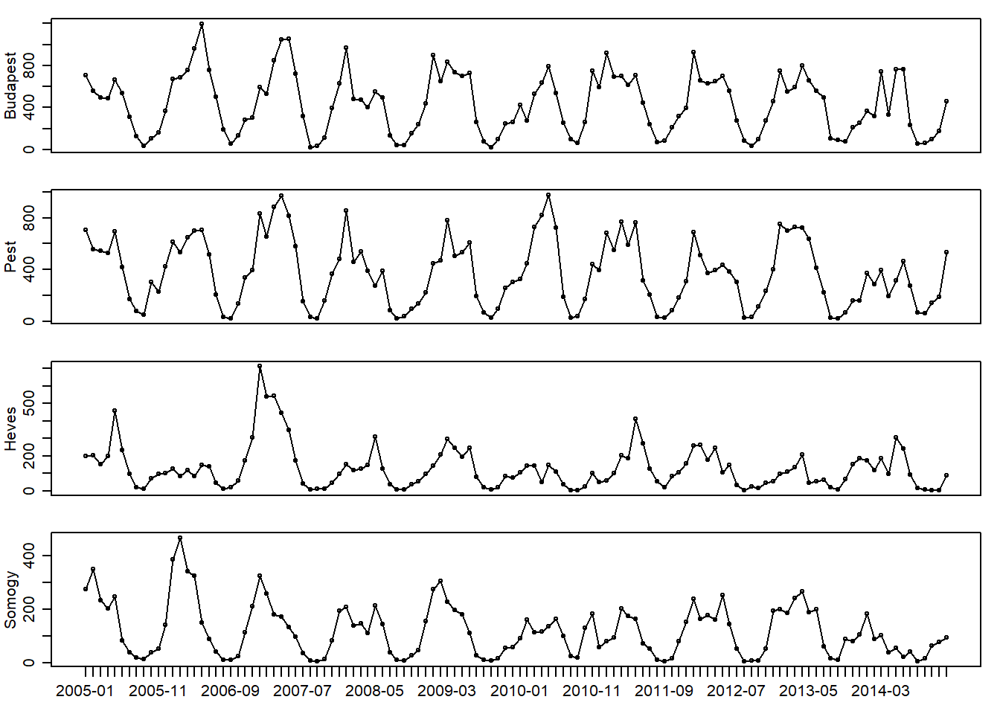

# Chickenpox Time Series


``` r
knitr::opts_chunk$set(warning = FALSE)
 # Suppress warnings
```

## Introduction

Treatment of chickenpox (varicella) cases uses up significant economic resources in Hungary. The Hungarian authorities were interested in the past in determining whether widespread distribution of a chickenpox vaccine would be appropriate (Meszner, Molnar, Rampakakis, Yang, Kuter, & Lara, 2017). The data used for this project are 521 weekly Hungarian chickenpox case counts by county from 2005 to 2014 inclusive, with Budapest regarded as its own administrative region. This data were provided publicly by Rozemberczki, Scherer, Kiss, Sarkar, and Ferenci (2021) and downloaded from the UCI Machine Learning Repository (University of California, 2021).

The decision to make vaccines publicly available was already approved in 2018 (“Hungary to provide chickenpox vaccine”, 2018). Nevertheless, the data set may still be able to provide additional insights.

My research question is to study whether population density plays a role in the behaviour of the time series. I am interested in whether higher population density may result in a greater number of “super-spreader” events. One key factor will be seasonality in the data set, as it is thought that that colder seasons and the timing of the school year have a significant effect on chickenpox cases (Rozemberczki et al., 2021). This may have different effects in the regions of differing population density.

A natural choice in answering this research question is to fit multiplicative seasonal ARIMA models to the chickenpox case numbers, as we can study both seasonality and the case-number dependence on previous values and forecast errors. We will do so for four chosen Hungarian regions.

## Exploratory data analysis

Administratively, Hungary is split up into its counties, while the capital city, Budapest, is given a separate designation. Budapest which has, by far, the highest population density in the data set, was an obvious choice to include in my study. Of the remaining data sets, I have chosen the counties with the highest, median and lowest population densities, which are Pest, Heves and Somogy respectively (Hungarian Central Statistical Office, 2019).

On a technical note, I chose to aggregate the weekly data into monthly data. Weekly data is difficult to handle for many reasons, particularly since the seasonal period is not exactly 52 (Hyndman & Athanasopoulos, 2021).


``` r
plot1 <- function() {par(mfrow=c(1,1),mar=c(5.1,4.1,4.1,2.1),mgp=c(3,1,0),oma=c(0,0,0,0))}

chickenpox = read.csv("data/hungary_chickenpox.csv",header=T,stringsAsFactors = F)

library(fpp3)
```

```
## ── Attaching packages ──────────────────────────────────────────── fpp3 1.0.3 ──
```

```
## ✔ tibble      3.3.1     ✔ tsibble     1.2.0
## ✔ dplyr       1.2.0     ✔ tsibbledata 0.4.1
## ✔ tidyr       1.3.2     ✔ ggtime      0.2.0
## ✔ lubridate   1.9.5     ✔ feasts      0.5.0
## ✔ ggplot2     4.0.2     ✔ fable       0.5.0
```

```
## ── Conflicts ───────────────────────────────────────────────── fpp3_conflicts ──
## ✖ lubridate::date()    masks base::date()
## ✖ dplyr::filter()      masks stats::filter()
## ✖ tsibble::intersect() masks base::intersect()
## ✖ tsibble::interval()  masks lubridate::interval()
## ✖ dplyr::lag()         masks stats::lag()
## ✖ tsibble::setdiff()   masks base::setdiff()
## ✖ tsibble::union()     masks base::union()
```

``` r
library(writexl)
library(bayesforecast)
```

```
## Registered S3 methods overwritten by 'bayesforecast':
##   method      from    
##   autoplot.ts forecast
##   forecast.ts forecast
##   fortify.ts  forecast
```

```
## 
## Attaching package: 'bayesforecast'
```

```
## The following objects are masked from 'package:fabletools':
## 
##     model, report
```

```
## The following objects are masked from 'package:base':
## 
##     beta, gamma
```

``` r
library(forecast)
```

```
## 
## Attaching package: 'forecast'
```

```
## The following objects are masked from 'package:bayesforecast':
## 
##     fourier, naive
```

``` r
chickenpox$Date = as.Date(chickenpox$Date, "%d/%m/%Y")
pox = chickenpox %>% as_tsibble(index = Date)
season = 12; test = 12; itns = 2000

# convert to monthly data
buda1 = pox %>% select(BUDAPEST) %>% index_by(Month = yearmonth(Date)) %>% summarise(Cases=sum(BUDAPEST))
# check for outliers
buda1_decomp <- buda1 %>% fabletools::model(STL(Cases)) %>% components()
buda1_decomp %>% filter(remainder < quantile(remainder, 0.25) - 4*IQR(remainder) | remainder > quantile(remainder, 0.75) + 4*IQR(remainder))
```

```
## # A dable: 0 x 7 [?]
## # Key:     .model [0]
## # :        Cases = trend + season_year + remainder
## # ℹ 7 variables: .model <chr>, Month <mth>, Cases <int>, trend <dbl>,
## #   season_year <dbl>, remainder <dbl>, season_adjust <dbl>
```

``` r
# adjust for heteroskedasticity
bc.lambda.buda <- buda1 %>% features(Cases, guerrero) %>% pull(lambda_guerrero)

par(mfcol=c(4,1),mar=c(1,2.75,1,1),mgp=c(1.75,.75,0),oma=c(1.5,0,0,0))
plot.buda = ts(as.numeric(buda1$Cases),freq=season,start=2005)
plot(plot.buda,xaxt = "n",type='o',ylab="Budapest")

pest1 = pox %>% select(PEST) %>% index_by(Month = yearmonth(Date)) %>% summarise(Cases=sum(PEST))
pest1_decomp <- pest1 %>% fabletools::model(STL(Cases)) %>% components()
pest1_decomp %>% filter(remainder < quantile(remainder, 0.25) - 4*IQR(remainder) | remainder > quantile(remainder, 0.75) + 4*IQR(remainder))
```

```
## # A dable: 0 x 7 [?]
## # Key:     .model [0]
## # :        Cases = trend + season_year + remainder
## # ℹ 7 variables: .model <chr>, Month <mth>, Cases <int>, trend <dbl>,
## #   season_year <dbl>, remainder <dbl>, season_adjust <dbl>
```

``` r
bc.lambda.pest <- pest1 %>% features(Cases, guerrero) %>% pull(lambda_guerrero)
plot.pest = ts(as.numeric(pest1$Cases),freq=season,start=2005)
plot(plot.pest,xaxt = "n",type='o',ylab="Pest")

heves1 = pox %>% select(HEVES) %>% index_by(Month = yearmonth(Date)) %>% summarise(Cases=sum(HEVES))
heves1_decomp <- heves1 %>% fabletools::model(STL(Cases)) %>% components()
heves1_decomp %>% filter(remainder < quantile(remainder, 0.25) - 4*IQR(remainder) | remainder > quantile(remainder, 0.75) + 4*IQR(remainder))
```

```
## # A dable: 1 x 7 [1M]
## # Key:     .model [1]
## # :        Cases = trend + season_year + remainder
##   .model        Month Cases trend season_year remainder season_adjust
##   <chr>         <mth> <int> <dbl>       <dbl>     <dbl>         <dbl>
## 1 STL(Cases) 2007 Jan   712  280.        86.5      346.          626.
```

``` r
bc.lambda.heves <- heves1 %>% features(Cases, guerrero) %>% pull(lambda_guerrero)
plot.heves = ts(as.numeric(heves1$Cases),freq=season,start=2005)
plot(plot.heves,xaxt = "n",type='o',ylab="Heves")

somogy1 = pox %>% select(SOMOGY) %>% index_by(Month = yearmonth(Date)) %>% summarise(Cases=sum(SOMOGY))
somogy1_decomp <- somogy1 %>% fabletools::model(STL(Cases)) %>% components()
somogy1_decomp %>% filter(remainder < quantile(remainder, 0.25) - 4*IQR(remainder) | remainder > quantile(remainder, 0.75) + 4*IQR(remainder))
```

```
## # A dable: 0 x 7 [?]
## # Key:     .model [0]
## # :        Cases = trend + season_year + remainder
## # ℹ 7 variables: .model <chr>, Month <mth>, Cases <int>, trend <dbl>,
## #   season_year <dbl>, remainder <dbl>, season_adjust <dbl>
```

``` r
bc.lambda.somogy <- somogy1 %>% features(Cases, guerrero) %>% pull(lambda_guerrero)
plot.somogy = ts(as.numeric(somogy1$Cases),freq=season,start=2005)
plot(plot.somogy,xaxt = "n",type='o',ylab="Somogy")
dates = as.Date(somogy1$Month); sequence = attributes(plot.somogy)$tsp
axis(1, at = seq(sequence[1], sequence[2], along = plot.somogy), labels = format(dates, "%Y-%m"))
```


*Figure 1 – Monthly chickenpox cases in Budapest, Pest, Heves, and Somogy from 2005 to 2014*

Let us define an outlier as an observation that is either greater than 3 interquartile ranges above the 0.75 quantile, or 3 interquartile ranges below the 0.25 quantile, a fairly strict criteria detailed by Hyndman and Athanasopoulos (2021).

The only observation that qualifies as an outlier under this criteria is the case number for January 2007 in the Heves series, which has a very clear peak in Figure 1. However, if we replace this observation with the average of the cases in January of the preceding and subsequent year, this outlier case disappears, but the very next month, February 2007 exceeds the outlier threshold value. Likewise, this behaviour repeats if we adjust the February 2007 observation. This process repeats itself until we replace the April 2007 observation, but then other observations at different times are flagged. Hence, it can be regarded that these values may not be true outliers, such as a once-off super-spreader event. Therefore, no change is made to the Heves series.

## Methodology

### Initial setup

This project will use R to fit Bayesian models (R Core Team, 2021). The interface used to write in R is RStudio (RStudio Team, 2021). The Stan programming language is indirectly used (Carpenter et al., 2017). Please see Appendices 1 and 2 for R packages used and R code respectively.
The aggregation into monthly data was done computationally using the fpp3 package in R, which automatically loads some packages in the tidyverse collection of packages (Hyndman, 2021). This reduces the number of observations to 120 months’ worth of case counts, of which we will take 108 as training data and 12 as test data.
Finally, as discussed in Hyndman and Athanasopoulos (2021), fpp3 is used to determine the value for $\lambda$ in a Box-Cox transformation, in order to adjust for heteroskedasticity in the time series. Assuming the untransformed monthly series is $(x_t)$, this transformation is achieved for non-zero $\lambda$ via the formula $y_t = (x_t^\lambda - 1)/\lambda$.

Central to our methodology is the R package bayesforecast, which interfaces with the programming language Stan, to fit Bayesian time series models (Alonzo & Cruz, 2020).

### Order selection

bayesforecast used for ARIMA order selection, the algorithm for which is described below. Note that the process compares the BIC of frequentist fittings to find the preferred order.

Firstly, the following constraints are made for a multiplicative seasonal ARIMA model

$$
y_t \sim SARIMA(p,d,q)(P,D,Q)_{12}
$$

- $p + q + P + Q \leq 6$
- $d + D \leq 2$
- $0 \leq p \leq 5, 0 \leq d \leq 2, 0 \leq q \leq 5$
- $0 \leq P \leq 2, 0 \leq D \leq 2, 0 \leq Q \leq 2$

Steps for model selection, with exhaustive search and approximations off (stepwise=FALSE,approximation=FALSE), are based on the algorithm by Hyndman and Khandakar (2008). The first two steps are used to ensure stationarity.

1. Use Kwiatkowski–Phillips–Schmidt–Shin test(s) to determine $d$.
2. Use the period of an STL decomposition to determine $D$.
3. Exhaustively check the BIC of all possible models within the constraints to determine the preferred ${p,d,q,P,D,Q}$.

### Prior and posterior distributions

#### Sampling model
As previously, take $(x_t)$ as the untransformed monthly series. After the Box-Cox transformation, we have
$y_t = (x_t^\lambda - 1)/\lambda$.

We can determine from our fittings in Section 2.2 that the maximum order of coefficients for the models we need to fit for our sampling model is

$$y_t | \boldsymbol{\gamma} \sim \text{SARIMA}(1,0,2)(2,1,2)_{12}$$
where $\boldsymbol{\gamma}$ represents the parameters of the model.

Hence, we can simply determine the posterior distribution assuming this model, but all of the fitted models will have lower order coefficients than this one.

Our sampling model is equivalently expressed as described below.
$$
(1-\phi B)(1-\Phi_1 B^{12}-\Phi_2 B^{24})(1-B^{12})(y_t-\mu)
=
(1+\theta_1 B+\theta_2 B^2)(1+\Theta_1 B^{12}+\Theta_2 B^{24})\epsilon_t
$$

Therefore,

$$
\begin{aligned}
y_t ={}& \mu + \epsilon_t + \theta_1\epsilon_{t-1}
+ \theta_2\epsilon_{t-2} + \Theta_1\epsilon_{t-12}
+ \theta_1\Theta_1\epsilon_{t-13}
+ \theta_2\Theta_1\epsilon_{t-14}
+ \Theta_2\epsilon_{t-24}
+ \theta_1\Theta_2\epsilon_{t-25} \\
&+ \theta_2\Theta_2\epsilon_{t-26}
+ \phi(y_{t-1}-\mu)
+ (1+\Phi_1)(y_{t-12}-\mu)
- (\phi+\phi\Phi_1)(y_{t-13}-\mu) \\
&+ (\Phi_2-\Phi_1)(y_{t-24}-\mu)
+ (\phi\Phi_1-\phi\Phi_2)(y_{t-25}-\mu)
- \Phi_2(y_{t-36}-\mu) \\
&+ \phi\Phi_2(y_{t-37}-\mu),
\quad \epsilon_t \mid \sigma \sim N(0, sd=\sigma).
\end{aligned}
$$
(Equation 1)

Take $\epsilon_{11} = \cdots = \epsilon_{36} = 0$.

Hence, the likelihood for our sampling model is given by

$$
\begin{aligned}
y_t \mid \{&\mu, \sigma, \phi, \Phi_1, \Phi_2, \theta_1, \theta_2,
\Theta_1, \Theta_2, \epsilon_t, \epsilon_{t-1}, \epsilon_{t-2},
\epsilon_{t-13}, \epsilon_{t-14}, \epsilon_{t-24},
\epsilon_{t-25}, \epsilon_{t-26}, \\
&y_{t-1}, y_{t-12}, y_{t-13}, y_{t-24}, y_{t-25},
y_{t-36}, y_{t-37}, y_1, \ldots, y_{36}\}
\sim N(*, sd=\sigma)
\end{aligned}
$$

where * is the expression on the right-hand side of Equation 1 and $t = 37, \cdots, 108. (In ARIMA models, the sampling model is assumed to be normal.)

Define 

$$
\begin{aligned}
\widehat{y}_t ={}& \mu + E[\epsilon_t]
+ \theta_1\epsilon_{t-1} + \theta_2\epsilon_{t-2}
+ \Theta_1\epsilon_{t-12}
+ \theta_1\Theta_1\epsilon_{t-13}
+ \theta_2\Theta_1\epsilon_{t-14}
+ \Theta_2\epsilon_{t-24}
+ \theta_1\Theta_2\epsilon_{t-25} \\
&+ \theta_2\Theta_2\epsilon_{t-26}
+ \phi(y_{t-1}-\mu)
+ (1+\Phi_1)(y_{t-12}-\mu)
- (\phi+\phi\Phi_1)(y_{t-13}-\mu) \\
&+ (\Phi_2-\Phi_1)(y_{t-24}-\mu)
+ (\phi\Phi_1-\phi\Phi_2)(y_{t-25}-\mu)
- \Phi_2(y_{t-36}-\mu) \\
&+ \phi\Phi_2(y_{t-37}-\mu) \\[1em]
={}& \mu + \theta_1\epsilon_{t-1} + \theta_2\epsilon_{t-2}
+ \Theta_1\epsilon_{t-12}
+ \theta_1\Theta_1\epsilon_{t-13}
+ \theta_2\Theta_1\epsilon_{t-14}
+ \Theta_2\epsilon_{t-24}
+ \theta_1\Theta_2\epsilon_{t-25}
+ \theta_2\Theta_2\epsilon_{t-26} \\
&+ \phi(y_{t-1}-\mu)
+ (1+\Phi_1)(y_{t-12}-\mu)
- (\phi+\phi\Phi_1)(y_{t-13}-\mu) \\
&+ (\Phi_2-\Phi_1)(y_{t-24}-\mu)
+ (\phi\Phi_1-\phi\Phi_2)(y_{t-25}-\mu)
- \Phi_2(y_{t-36}-\mu) \\
&+ \phi\Phi_2(y_{t-37}-\mu).
\end{aligned}
$$
(Equation 2)

At iteration $t$ of our algorithm, we will generate $\epsilon_t$ from
$\epsilon_t \mid \sigma \sim N(0, sd = \sigma)$ iid for $t = 37, \ldots, 108$.
However, for any iteration prior iteration $n = 1, \ldots, t$ set
$\epsilon_n = y_n - \widehat{y}_n$, as defined in Equation 2.
